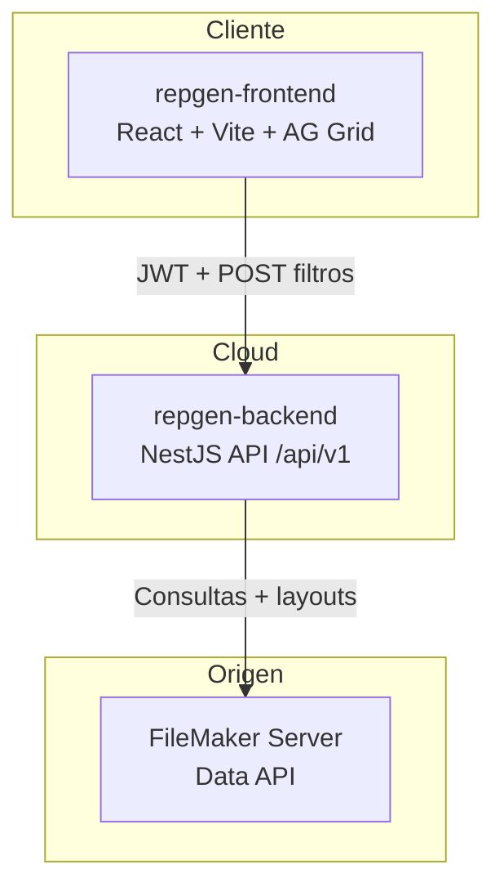

# [DOC] RepGen — Documentación técnica y operativa

**Tipo Jira:** Epic  
**Labels:** `documentation`, `repgen`, `knowledge-base`

---

## Objetivo

Documentar el sistema **RepGen** (consulta y presentación de reportes empresariales sobre datos de **FileMaker**) para facilitar onboarding, mantenimiento, despliegue y evolución del producto sin depender de conocimiento tribal.

## Alcance

| Incluido | Detalle |
|----------|---------|
| Monorepo | `repgen-backend` (NestJS), `repgen-frontend` (React + Vite) |
| Dominio principal | Reportes: bancos, ventas, ítems de venta |
| Integraciones | FileMaker Data API, autenticación por token FM → JWT |
| Multi-tenant | Tenant en login; etiquetas de columnas por cliente |
| Operación | CI/CD (GitHub Actions), Vercel, DigitalOcean, logging |

## Fuera de alcance (salvo epic aparte)

- Manuales de usuario final (UX paso a paso para negocio)
- Documentación interna del esquema FileMaker del cliente (layouts, scripts FM)
- Migración de arquitectura (se referencia en Tarea 2; implementación = historias de desarrollo)

## Audiencia

- Desarrolladores backend y frontend
- DevOps / soporte de aplicaciones
- Producto y analistas (flujos funcionales y reglas de negocio de reportes)

## Arquitectura de alto nivel

## Estructura del backlog de documentación

| Tarea | Título corto |
|-------|----------------|
| DOC-1 | Visión general y contexto |
| DOC-2 | Arquitectura y convenciones |
| DOC-3 | Backend transversal |
| DOC-4 | Auth, usuario y tenant |
| DOC-5 | Integración FileMaker |
| DOC-6 | Dominio reportes |
| DOC-7 | Frontend |
| DOC-8 | Despliegue y CI/CD |
| DOC-9 | Operación y soporte |
| DOC-10 | Onboarding desarrollador |
| DOC-11 | Configuraciones de columnas guardadas |

Archivos detallados: `docs/jira/tasks/01-*.md` … `10-*.md`

## Fuentes de verdad en Git

- `README.md` (raíz) — enlaces a despliegue
- `PROUESTA_ARQUITECTURA.md` — estructura objetivo y plan de migración
- `repgen-backend/docs/reports/` — flujo reportes, field maps, ADRs ventas
- `.github/DEPLOYMENT.md` — secrets y pipelines
- `LOGGER_IMPLEMENTATION.md`, `LOGGER_QUICK_START.md` — observabilidad

## Criterios de cierre del Epic

- [ ] Índice maestro en Confluence o `docs/jira/README.md` actualizado con enlaces a issues Jira
- [ ] Flujo E2E de reportes documentado y enlazado al código
- [ ] Runbook de despliegue con variables de entorno (sin secretos en Jira)
- [ ] Guía «Cómo agregar un reporte nuevo» publicada (`docs/jira/guides/COMO-AGREGAR-REPORTE.md`)
- [ ] Al menos un par de revisión (peer review) en subtareas críticas (6.x, 8.x)

## Definition of Done (documentación)

1. Descripción en Jira con resumen + enlace a doc largo en Git si aplica  
2. Diagrama o tabla cuando el flujo tenga más de 3 pasos  
3. Rutas de archivos verificadas en rama principal  
4. Sin tokens, contraseñas ni datos reales de clientes  
