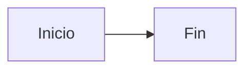

# Plantilla — Subtarea de documentación

Copia este bloque al crear una subtarea en Jira.

---

## Objetivo

(1–2 frases: qué debe entender el lector al terminar.)

## Audiencia

- [ ] Desarrollador
- [ ] DevOps / Soporte
- [ ] Producto / Analista

## Proceso / flujo

1. ...
2. ...

## Ubicación en código

| Archivo / carpeta | Rol |
|-------------------|-----|
| `ruta/ejemplo.ts` | ... |

## Documentación en repo

- Enlace: `ruta/al/doc.md`

## Diagrama

## Criterios de aceptación

- [ ] Flujo descrito de extremo a extremo
- [ ] Enlaces a archivos verificados en `main`
- [ ] Sin credenciales ni datos reales de cliente
- [ ] Revisado por otro miembro del equipo

## Notas / preguntas abiertas

- ...
