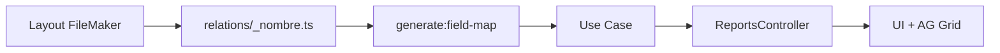

# Cómo agregar un reporte nuevo en RepGen

Guía E2E para desarrolladores. Complementa el **Field map guide** en [references/LINKS.md](../../references/LINKS.md) (repo `repgen-backend`) y la subtarea Jira **DOC-6.9**.

---

## Resumen del flujo



---

## Checklist

### 1. FileMaker (con equipo FM o documentación cliente)

- [ ] Layout / tabla origen definido
- [ ] Campos necesarios listados (nombres FM reales)
- [ ] Portales identificados (si hay hijos)
- [ ] Script o proceso para token de prueba en dev

### 2. Relación backend

- [ ] Crear `repgen-backend/src/filemaker/relations/_<nombre>.ts`
- [ ] Exportar en `relations/index.ts`
- [ ] Probar consulta mínima desde `FileMakerService` (script o test manual)

Ejemplo existente: `_banks.ts`, `_sales.ts`, `_sales.item.ts`

### 3. Scaffold con generador

```bash
cd repgen-backend
pnpm generate:field-map --report <nombre-reporte>
```

Genera (entre otros):

- `domain/<nombre>/<nombre>-report.types.ts`
- `infrastructure/<nombre>/*-field-map.ts`, `*.mapper.ts`, `*-report.schema.json`
- `application/<nombre>/get-<nombre>-report.use-case.ts`

- [ ] Completar mapeos en `*-field-map.ts` con campos FM reales
- [ ] Implementar lógica en `*.mapper.ts` (reglas de negocio aquí, no en BaseReportService)

### 4. Integrar en módulo reportes

- [ ] Registrar use case en `reports.module.ts`
- [ ] Inyectar en `reports.controller.ts`
- [ ] Reutilizar `SearchReportDto` (`presentation/dto/search-report.dto.ts`): el body solo lleva `dateRange`
- [ ] Añadir endpoint, por ejemplo:

```typescript
@Post('<ruta>/buscar')
@HttpCode(200)
async getXReports(
  @Body() { dateRange }: SearchReportDto,
  @Request() req: AuthenticatedRequest,
): Promise<ReportResponse<ReportXRecord>> {
  return this.reportServiceX.fetchReport(dateRange, req.tenant, req.id);
}
```

- [ ] Aplicar `@Throttle` si el reporte es costoso (ver bancos: 20/min)

### 5. Permisos (si aplica)

- [ ] ¿Filtrar por usuario? → ver `banks.permissions.filter.ts` como patrón
- [ ] ¿Nuevo tipo de permiso? → extender `user/` module

### 6. Tests backend

- [ ] Unit test mapper con `RawRecord` de ejemplo (`_namefields/` tiene JSON de referencia)
- [ ] Test use case o `base-report.service` con mocks FM

### 7. Frontend

- [ ] Crear `features/reports/<nombre>/ui/Reporte<Nombre>.tsx`
- [ ] Config AG Grid: `config/<nombre>.columnas.ts` + `*.schema.json`
- [ ] Usar `useReporteBase` (trae todo el rango de fechas; AG Grid filtra en el cliente)
- [ ] Añadir ruta / entrada en `Sidebar`
- [ ] Método en `api.reportes.ts` o `features/reports/shared/api/reportes.api.ts`
- [ ] Tests Vitest básicos (render + mock API)

### 8. Documentación

- [ ] Entrada en `repgen-backend/docs/reports/INDEX.md`
- [ ] Si hay reglas de negocio no obvias: ADR en `docs/reports/ADR/<NOMBRE>/`
- [ ] Actualizar subtarea Jira DOC-6.x si es reporte de producto

### 9. Verificación final

- [ ] `pnpm build` backend y frontend
- [ ] Prueba manual: login → rango de fechas → filtros de columna → export (si aplica)
- [ ] Revisar logs sin errores FM

---

## Convención de nombres

| Elemento | Ejemplo |
|----------|---------|
| Carpeta reporte | `sales`, `banks`, `salesitem` |
| Endpoint | `ventas/buscar`, `bancos/buscar` |
| Ruta FE | `/reportes/ventas` |
| Schema JSON | `sales-report.schema.json` |

---

## Referencias rápidas

| Tema | Archivo |
|------|---------|
| Flujo general | [LINKS.md — backend](../../references/LINKS.md) |
| Field maps | [FIELD_MAP_GUIDE](../../../repgen-backend/docs/reports/FIELD_MAP_GUIDE.md) |
| Controller / Base service | Rutas en [LINKS.md](../../references/LINKS.md) |

---

## Anti-patrones

- Poner reglas de negocio en `BaseReportService`
- Hardcodear nombres de campo FM en el controller
- Omitir `tenant` en consultas multi-cliente
- Subir credenciales o dumps FM reales al repositorio
