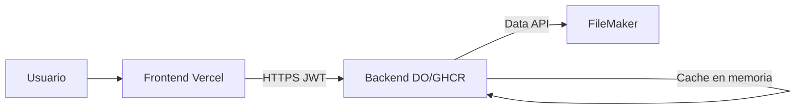

# DOC-1 — Visión general y contexto del producto

**Tipo Jira:** Story / Task  
**Epic:** [DOC] RepGen — Documentación técnica y operativa  
**Component:** General

---

### SUB-1.1 — Propósito del producto y usuarios

**Summary Jira:** `[DOC-1.1] Propósito de RepGen y usuarios`

## Objetivo

Definir qué problema resuelve RepGen, quién lo usa y qué espera cada perfil.

## Contenido a documentar

**RepGen** es una aplicación web que expone reportes operativos y financieros (bancos, ventas, detalle de ítems) consultando datos en tiempo (casi) real desde **FileMaker**, con filtros avanzados, paginación y visualización en tablas dinámicas (AG Grid).

| Perfil | Necesidad |
|--------|-----------|
| Usuario de negocio | Ver y filtrar reportes; exportar; KPIs laterales |
| Desarrollador | Extender reportes, mappers, APIs |
| DevOps | Desplegar FE/BE, configurar secrets |
| Soporte | Diagnosticar errores FM / auth / tenant |

## Criterios de aceptación

- [ ] Párrafo de propósito (máx. 150 palabras)
- [ ] Tabla de perfiles vs necesidades
- [ ] Lista de reportes actuales: Bancos, Ventas, Sales Item (ítems)

---

### SUB-1.2 — Arquitectura de alto nivel

**Summary Jira:** `[DOC-1.2] Diagrama arquitectura RepGen`

## Objetivo

Diagrama y texto que expliquen la separación frontend / backend / FileMaker.

## Diagrama



## Puntos clave

- Prefijo API global: `/api/v1/` (`repgen-backend/src/main.ts`)
- CORS limitado a `FRONTEND_URL`
- Autenticación: token FileMaker → validación → JWT para llamadas posteriores

## Criterios de aceptación

- [ ] Diagrama en Confluence o adjunto en Jira
- [ ] Puertos por defecto: BE `3000`, FE `5173` (dev)

---

### SUB-1.3 — Estructura del monorepo

**Summary Jira:** `[DOC-1.3] Estructura carpetas RepGen`

## Objetivo

Mapa de carpetas de nivel 1 y 2 para ubicar código rápidamente.

## Estructura

```
RepGen/
├── repgen-backend/     # NestJS API
│   ├── src/
│   │   ├── auth/
│   │   ├── filemaker/
│   │   ├── reports/    # presentation | application | domain | infrastructure
│   │   ├── tenant/
│   │   ├── user/
│   │   └── common/
│   ├── docs/reports/   # Documentación técnica reportes
│   └── env-presets/    # Plantillas .env
├── repgen-frontend/    # React + Vite
│   └── src/
│       ├── app/
│       ├── features/   # auth, reports
│       ├── shared/
│       └── components/ # legacy en migración
├── docs/jira/          # Este backlog
├── .github/workflows/  # CI y deploy
└── PROUESTA_ARQUITECTURA.md
```

## Criterios de aceptación

- [ ] Tabla carpeta → responsabilidad
- [ ] Enlace a `env-presets` para cada entorno

---

### SUB-1.4 — Glosario de términos

**Summary Jira:** `[DOC-1.4] Glosario RepGen`

## Términos

| Término | Definición |
|---------|------------|
| **Tenant** | Identificador de cliente/instancia; va en login y en `req.tenant` |
| **Field map** | JSON que mapea nombre limpio (código) → campo FileMaker |
| **RawRecord** | Registro crudo FM: `fieldData` + `portalData` opcional |
| **FilterModel** | Filtros AG Grid serializados (`filterType`, `type`, `filter`) |
| **Mapper** | Transforma `RawRecord[]` → registros del reporte |
| **Use case** | Orquesta consulta vía `BaseReportService` |
| **Column labels** | Etiquetas UI personalizadas por tenant (`GET /tenant/column-labels`) |
| **Portal** | Relación/hijos en FM (ej. devoluciones en ventas) |

## Criterios de aceptación

- [ ] Mínimo 8 términos definidos
- [ ] Enlace cruzado a SUB-6.1 (flujo reportes)
