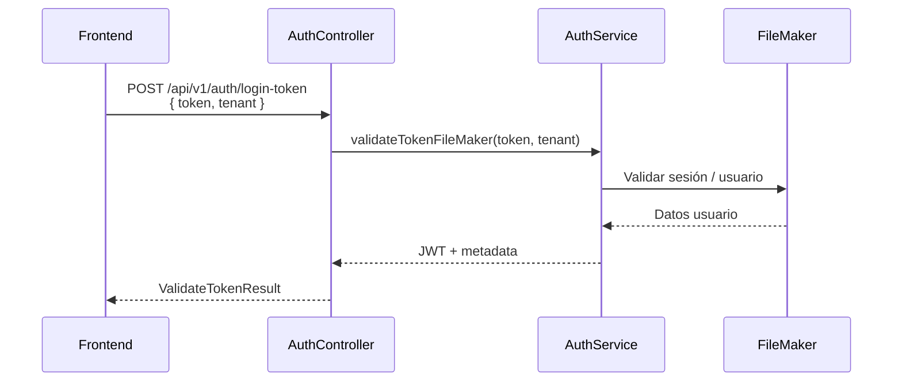
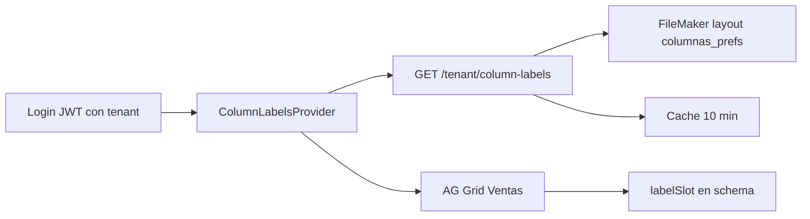

# DOC-4 — Autenticación, usuario y tenant

**Tipo Jira:** Story / Task  
**Epic:** [DOC] RepGen — Documentación técnica y operativa  
**Component:** Backend

---

### SUB-4.1 — Flujo de login (token FileMaker → JWT)

**Summary Jira:** `[DOC-4.1] Flujo login FileMaker JWT`

## Objetivo

Documentar el único flujo de autenticación público.

## Secuencia



## Endpoint

- `POST /api/v1/auth/login-token` — **público** (`@Public()`)
- Body: `token` (desde FileMaker), `tenant` (obligatorio)
- Throttle: 5 req/min

## Archivos

- `src/auth/auth.controller.ts`
- `src/auth/auth.service.ts`
- `src/auth/auth-field-map.ts`

## Criterios de aceptación

- [ ] Ejemplo request/response (tokens ficticios)
- [ ] Errores: token vacío, tenant vacío

---

### SUB-4.2 — JWT, guards y request autenticado

**Summary Jira:** `[DOC-4.2] JWT guard y AuthenticatedRequest`

## Objetivo

Cómo se protegen rutas y qué llega en `req`.

## Archivos

- `src/auth/guards/jwt.auth.guard.ts`
- `src/auth/guards/ijwt.ts` — tipo `AuthenticatedRequest`
- Decorador `@Public()` para excepciones

## Campos típicos en request

- `req.tenant` — usado en reportes y tenant
- `req.id` — identificador usuario para permisos

## Criterios de aceptación

- [ ] Lista de rutas públicas vs protegidas
- [ ] Cómo el FE envía el JWT (header / cookie — verificar implementación FE)

---

### SUB-4.3 — Permisos por banco (UserModule)

**Summary Jira:** `[DOC-4.3] Permisos bancos por usuario`

## Objetivo

Restricción de cuentas/bancos visibles en reporte bancos.

## Archivos

- `src/user/application/get-bank-permissions-use-case.ts`
- `src/user/infrastructure/user-bank-permission-field-map.ts`
- `src/user/domain/user-bank-permissions-types.ts`
- `src/reports/infrastructure/banks/banks.permissions.filter.ts`

## Proceso

1. Tras login, el use case obtiene permisos FM del usuario
2. Al buscar bancos, el filtro reduce registros según permisos

## Criterios de aceptación

- [ ] Diagrama permisos → consulta FM
- [ ] Comportamiento si usuario sin permisos

---

### SUB-4.4 — Tenant y etiquetas de columnas (Column Labels)

**Summary Jira:** `[DOC-4.4] Column labels por tenant`

**Documentación completa (copiar a Jira / Confluence):**  
Ver enlace **DOC-4.4 Column labels** en [references/LINKS.md](../../references/LINKS.md) (repo `repgen-backend`).

---

## Objetivo

Permitir que cada **tenant** (base FileMaker / cliente) defina cómo se llaman en pantalla las columnas de clasificación de **cliente** y **artículo**, sin cambiar código del frontend por cada cliente.

Ejemplo: en lugar de «Clasificación 1» fijo, el usuario ve «CANAL» o «RUTA» según lo configurado en FileMaker.

---

## Resumen del flujo



1. El **tenant** entra en el JWT al hacer login (`tenant` = nombre de base FM).
2. Tras autenticarse, el FE envuelve la app en `ColumnLabelsProvider`.
3. El provider pide etiquetas al backend (o usa `sessionStorage` si ya las tenía).
4. En **reporte ventas**, columnas con `labelSlot` en `ventas.schema.json` muestran el texto del tenant; si falta, usan `defaultHeader`.

---

## API

| | |
|---|---|
| **Método** | `GET /api/v1/tenant/column-labels` |
| **Auth** | Bearer JWT (obligatorio) |
| **Tenant** | Del claim JWT (`req.tenant`), no por query |
| **Origen datos** | FileMaker: base = `tenantId`, layout = `columnas_prefs`, primer registro |

### Respuesta 200 (contrato)

```json
{
  "cliente": {
    "clasificacion1": "CANAL",
    "clasificacion2": "RUTA",
    "clasificacion3": "",
    "clasificacion4": ""
  },
  "articulo": {
    "categoria1": "LÍNEA",
    "categoria2": "FAMILIA",
    "categoria3": "",
    "categoria4": ""
  }
}
```

### Errores a documentar / probar

| HTTP | Causa |
|------|--------|
| 401 | Sin token o JWT inválido |
| 400 | Tenant vacío en JWT |
| 404 | No hay registro en `columnas_prefs` |

---

## Slots soportados (8)

| Slot (`labelSlot`) | Uso |
|--------------------|-----|
| `cliente.clasificacion1` … `clasificacion4` | Encabezados clasificación cliente en ventas |
| `articulo.categoria1` … `categoria4` | Encabezados categoría artículo en ventas |

Lista tipada FE: `repgen-frontend/src/shared/config/dynamic-column-slots.ts`.

---

## Backend — archivos clave

| Archivo | Responsabilidad |
|---------|-----------------|
| `tenant/presentation/tenant.controller.ts` | Expone GET |
| `tenant/tenant.service.ts` | Cache + `getAllRecords(tenant, 'columnas_prefs')` |
| `tenant/infrastructure/column-labels-field-map.ts` | Nombres campo FM |
| `tenant/infrastructure/column-labels.mapper.ts` | FM → JSON API |
| `filemaker/relations/_column-labels.ts` | Prefijos relación `_prefCLIENTE` / inventario |

**Caché:** clave `column-labels:{tenantId}`, TTL **10 minutos**.

---

## FileMaker

```typescript
// filemaker/relations/_column-labels.ts
export const columnLabelsRelations = {
  _: `_prefCLIENTE`,
  prefInv: {
    _: `_prefCliente_|_pref.invITM_|_x`,
  },
};
```

- Layout: **`columnas_prefs`**
- Se lee **un solo registro** (el primero devuelto por la API).
- Campos mapeados vía `column-labels-field-map.ts` (classify1–4 cliente + portal inventario).

---

## Frontend — archivos clave

| Archivo | Responsabilidad |
|---------|-----------------|
| `features/auth/ui/Autenticacion.tsx` | Monta `<ColumnLabelsProvider tenant={tenantActivo}>` |
| `features/reports/shared/context/ColumnLabelsProvider.tsx` | Fetch + estado |
| `features/reports/shared/api/column-labels.api.ts` | `GET` con `jwt_reportes` |
| `features/reports/shared/context/column-labels.context.ts` | `resolverSlot`, cache `sessionStorage` |
| `config/ag-grid/Reportes/ventas/ventas.schema.json` | `labelSlot` + `defaultHeader` por columna |
| `components/Reportes/ReporteVentas/ReporteVentas.tsx` | `useColumnLabels()` → `construirColumnasVentas(..., getLabel)` |

### Fallback

1. Si `getLabel(slot)` devuelve texto → **headerName** = ese texto.
2. Si no → **defaultHeader** del schema (ej. «Clasificación 1»).
3. Si la API falla pero hay cache en `sessionStorage` → se usan labels cacheadas.

**Nota:** reporte **bancos** no usa `labelSlot` hoy; solo **ventas**.

---

## Ejemplo columna en schema

```json
"clasificacion1": {
  "field": "clasificacion1",
  "labelSlot": "cliente.clasificacion1",
  "defaultHeader": "Clasificación 1"
}
```

---

## Pruebas sugeridas

- [ ] `pnpm test -- column-labels.mapper.spec` (backend)
- [ ] Login con tenant de dev → Network: `column-labels` 200
- [ ] Cambiar un texto en FM → esperar cache o reinicio → ver encabezado en grid ventas
- [ ] Tenant sin registro `columnas_prefs` → 404 y fallback a `defaultHeader`

---

## Criterios de aceptación (Jira)

- [ ] Descripción en Jira con enlace a `COLUMN_LABELS.md`
- [ ] Diagrama de secuencia o flujo adjunto
- [ ] Tabla de slots + columnas ventas verificada
- [ ] Errores 401/404 documentados para soporte
- [ ] Nota de alcance: solo ventas consumen labels hoy
