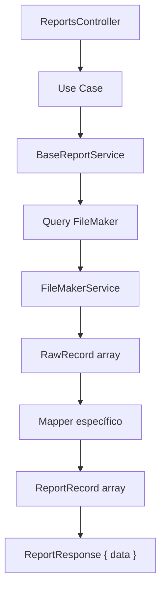

# DOC-6 — Dominio Reportes (núcleo)

**Tipo Jira:** Story / Task  
**Epic:** [DOC] RepGen — Documentación técnica y operativa  
**Component:** Reports

**Índice repo:** `repgen-backend/docs/reports/INDEX.md`

---

### SUB-6.1 — Índice y flujo general de reportes

**Summary Jira:** `[DOC-6.1] Flujo general reportes E2E`

## Objetivo

Documento hub que enlaza flujo completo controller → FM → mapper → respuesta.

## Diagrama

## Fuente en repo

`repgen-backend/docs/reports/workflow/EXPLICACION_FLUJO_REPORTES.md`

## Pasos resumidos

1. Controller recibe solo `dateRange` (el filtrado y la paginación son del lado del cliente)
2. Use case delega a `BaseReportService`
3. Servicio arma cache key (tenant + usuario + rango) y query (permisos × campos de fecha)
4. FM devuelve crudos → mapper → `{ data }`

## Criterios de aceptación

- [ ] Página Confluence o issue con diagrama + enlace Git
- [ ] Sin duplicar texto largo: resumen + link

---

### SUB-6.2 — API REST de reportes

**Summary Jira:** `[DOC-6.2] Endpoints REST reportes`

## Controller

`src/reports/presentation/reports.controller.ts`  
Base path: `/api/v1/reports`

| Método | Ruta | Use case |
|--------|------|----------|
| POST | `bancos/buscar` | `GetBankReportUseCase` |
| POST | `ventas/buscar` | `GetSalesReportUseCase` |
| POST | `ventas-por-concepto/buscar` | `GetSalesitemReportUseCase` |

## Body (DTO)

`SearchReportDto` (común a los tres): `{ dateRange: { startDate, endDate } }` en formato `YYYY-MM-DD`. Sin query params; campos extra → 400.

## Respuesta

`{ data: Report*Record[] }` con todos los registros del rango que el usuario puede ver.

## Criterios de aceptación

- [ ] Tabla endpoint → DTO → tipo respuesta
- [ ] Throttle bancos: 20/min documentado

---

### SUB-6.3 — BaseReportService

**Summary Jira:** `[DOC-6.3] BaseReportService cache y query`

## Archivo

`src/reports/application/shared/base-report.service.ts`

## Responsabilidades

- Cache key y política de cache
- Construcción de consulta FileMaker
- Rango de fechas y permisos (una condición por permiso × campo de fecha)
- Invocación del mapper inyectado
- Respuesta `ReportResponse` (`{ data }`)

## Regla

No contiene reglas de negocio del reporte (cancelaciones, devoluciones → mapper).

## Criterios de aceptación

- [ ] Descripción `meta` (total, página, etc.)
- [ ] Tests: `base-report.service.spec.ts` referenciados

---

### SUB-6.4 — Reporte Bancos

**Summary Jira:** `[DOC-6.4] Documentación reporte Bancos`

## Flujo

`POST /reports/bancos/buscar` → `GetBankReportUseCase` → mapper bancos → permisos

## Archivos clave

| Capa | Ruta |
|------|------|
| Use case | `application/banks/get-bank-report.use-case.ts` |
| Mapper | `infrastructure/banks/banks.mapper.ts` |
| Field map | `infrastructure/banks/bank-field-map.ts` |
| Permisos | `infrastructure/banks/banks.permissions.filter.ts` |
| FM relation | `filemaker/relations/_banks.ts` |
| Schema | `infrastructure/banks/bank-report.schema.json` |

## Frontend relacionado

- `features/reports/banks/ui/ReporteBancos.tsx`
- `config/ag-grid/Reportes/bancos/`

## Criterios de aceptación

- [ ] Secuencia diagram
- [ ] 5 campos principales del reporte explicados
- [ ] Interacción con permisos (SUB-4.3)

---

### SUB-6.5 — Reporte Ventas y ADRs

**Summary Jira:** `[DOC-6.5] Documentación reporte Ventas`

## Archivos clave

| Capa | Ruta |
|------|------|
| Use case | `application/sales/get-sales-report.use-case.ts` |
| Mapper | `infrastructure/sales/sales.mapper.ts` |
| Field map | `infrastructure/sales/sales-field-map.ts` |
| FM relation | `filemaker/relations/_sales.ts` |

## Reglas de negocio (mapper)

Documentadas en `EXPLICACION_FLUJO_REPORTES.md` §5:

- Factura normal
- **Cancelación:** registro negativo si `fechaCFDICancelado` en rango
- **Devolución:** registro clonado desde portal NC

## ADRs

- `docs/reports/ADR/VENTAS/ADR-INDEX.md`
- ADR-0001 cancelación fuera de rango
- ADR-0002 devolución fuera de rango

## Criterios de aceptación

- [ ] Enlaces a ADRs desde Jira
- [ ] Casos de prueba manuales sugeridos (3 escenarios)

---

### SUB-6.6 — Reporte Sales Item (ítems venta)

**Summary Jira:** `[DOC-6.6] Documentación reporte Sales Item`

## Archivos

- `application/salesitem/get-salesitem-report.use-case.ts`
- `infrastructure/salesitem/salesitem.mapper.ts`
- `filemaker/relations/_sales.item.ts`

## Endpoint

`POST /reports/ventas-item/buscar`

## Criterios de aceptación

- [ ] Diferencia funcional vs reporte ventas cabecera
- [ ] Schema: `salesitem-report.schema.json`

---

### SUB-6.7 — Patrón Field Map

**Summary Jira:** `[DOC-6.7] Patrón Field Map`

## Fuente

`repgen-backend/docs/reports/FIELD_MAP_GUIDE.md`

## Archivos por reporte `x`

1. `domain/x/x-report.types.ts`
2. `infrastructure/x/x-field-map.ts`
3. `infrastructure/x/x-field-map.helper.ts`
4. `infrastructure/x/x.mapper.ts`
5. `application/x/get-x-report.use-case.ts`

## Criterios de aceptación

- [ ] Ejemplo entrada JSON field map (1 campo)
- [ ] Comando `generate:field-map` enlazado

---

### SUB-6.8 — DTOs y filtros desde UI

**Summary Jira:** `[DOC-6.8] DTOs búsqueda reportes`

## Carpeta

`src/reports/presentation/dto/`

## Objetivo

Documentar validación (`class-validator`) de `SearchReportDto`: `dateRange` obligatorio con fechas `YYYY-MM-DD`.

## Criterios de aceptación

- [ ] Ejemplo body completo ventas (anonimizado)
- [ ] Campos opcionales vs requeridos

---

### SUB-6.9 — Guía: agregar un reporte nuevo

**Summary Jira:** `[DOC-6.9] Guía nuevo reporte`

## Fuente generada

`docs/jira/guides/COMO-AGREGAR-REPORTE.md`

## Criterios de aceptación

- [ ] Checklist E2E publicado en repo
- [ ] Issue Jira enlaza al markdown
- [ ] Revisión con dev que haya hecho último reporte
