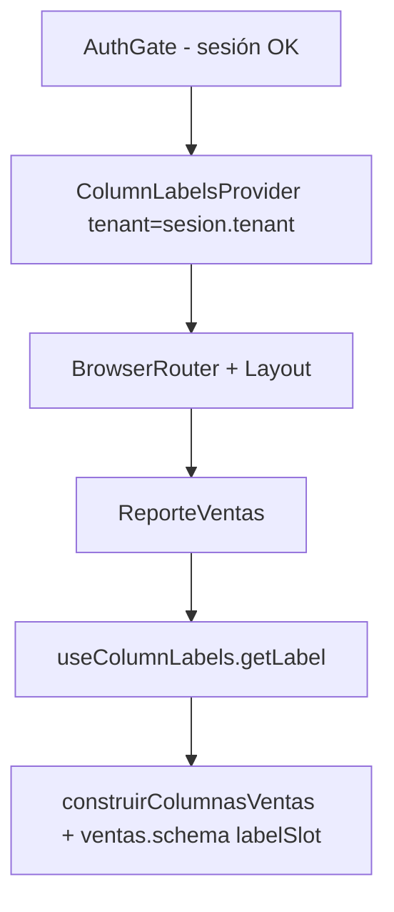

# DOC-7 — Frontend

**Tipo Jira:** Story / Task  
**Epic:** [DOC] RepGen — Documentación técnica y operativa  
**Component:** Frontend

---

### SUB-7.1 — Shell, routing y layout

**Summary Jira:** `[DOC-7.1] App shell y layout`

## Objetivo

Estructura de navegación y pantallas principales.

## Estado actual

- Entry: `src/main.tsx` → `src/app/App.tsx`: `AuthGate` valida la sesión y, con sesión, monta `ColumnLabelsProvider` + `app/router.tsx`
- Layout: `src/app/layout/` (`Layout.tsx`, `Navbar.tsx`, `Sidebar.tsx`, `navbarSlotContext.ts`)
- Sesión en el navegador: `src/features/auth/session.ts` (usuario no sensible; el JWT va en cookie httpOnly)

## Criterios de aceptación

- [ ] Diagrama rutas / pantallas post-login
- [ ] Qué reportes aparecen en Sidebar

---

### SUB-7.2 — Autenticación UI

**Summary Jira:** `[DOC-7.2] Pantalla autenticación`

## Archivo

`src/features/auth/AuthGate.tsx`

## Flujo

1. Usuario obtiene token en FileMaker (proceso externo)
2. FE envía `POST {API}/auth/login-token` con `token` + `tenant`
3. El backend devuelve el JWT en la cookie httpOnly `jwt_reportes`; el FE solo guarda `{ name, tenant }` en `localStorage["usuario:v1"]` y limpia `?token=` de la URL
4. Redirige a reportes
5. Sin `?token=`: si hay usuario guardado, confirma la sesión con `GET /auth/me` (401 → pide entrar desde FileMaker)

Detalle: `repgen-frontend/docs/AUTENTICACION_COOKIE_HTTPONLY.md`.

## Criterios de aceptación

- [ ] Variable `VITE_*` de URL API documentada
- [ ] Manejo de errores en UI

---

### SUB-7.3 — Reporte Bancos (UI)

**Summary Jira:** `[DOC-7.3] UI Reporte Bancos`

## Archivos

| Tipo | Ruta |
|------|------|
| Pantalla | `features/reports/banks/ReporteBancos.tsx` |
| Columnas AG Grid | `features/reports/banks/columnas.ts` |
| Schema | `features/reports/banks/bancos.schema.json` |

## Hook compartido

- `features/reports/shared/useReporteBase.ts` — fetch del rango de fechas (filtros y paginación los hace AG Grid en cliente)
- `features/reports/shared/useReporteGrid.ts` — referencia al grid, columnas visibles, contador de filas y vistas guardadas (aplica la predeterminada)

## Criterios de aceptación

- [ ] Flujo usuario: filtros → buscar → tabla
- [ ] Endpoint llamado: `POST .../reports/bancos/buscar`

---

### SUB-7.4 — Reporte Ventas (UI)

**Summary Jira:** `[DOC-7.4] UI Reporte Ventas`

## Archivos

- `features/reports/sales/ui/ReporteVentas.tsx`
- `features/reports/sales/` (tabs, tests)
- `features/reports/sales/columnas.ts`
- `ventas.schema.json`

## Particularidades

- Tabs (`TabsVentas.tsx`) si aplica cabecera vs detalle
- Reglas de negocio reflejadas en totales/KPIs (`PanelKpiLateral`)

## Criterios de aceptación

- [ ] Relación UI ↔ reglas cancelación/devolución (SUB-6.5)

---

### SUB-7.5 — Componentes compartidos (tabla, filtros, KPI)

**Summary Jira:** `[DOC-7.5] Componentes shared reportes`

## Componentes

| Componente | Ubicación |
|------------|-----------|
| TablaDinamica | `features/reports/shared/TablaDinamica/` |
| FiltroFechas, EncabezadoReporte, AccionesTabla, BotonExportar | `features/reports/shared/` |
| ConfiguracionesColumnas (vistas guardadas) | `features/reports/shared/ConfiguracionesColumnas/` |
| PanelKpiLateral, CardsKpi | `features/reports/shared/` |
| ModalColumnas | selector columnas visibles |

## AG Grid utils

- `features/reports/shared/ag-grid/construir-columnas.ts` — `ColDef` a partir del schema JSON
- `features/reports/shared/ag-grid/parametros-filtro.ts` — opciones de filtro por tipo de dato
- `features/reports/shared/ag-grid/predicados-filtro.ts` — predicados (contiene, igual, fechas…)
- `features/reports/shared/ag-grid/formato.ts`, `exportar.ts`
- Módulos de AG Grid: se registran una sola vez en `TablaDinamica.tsx` (solo los usados); `TablaDinamica.modulos.test.tsx` falla si falta uno

## Criterios de aceptación

- [ ] Props principales de `TablaDinamica`
- [ ] Export Excel/CSV si aplica

---

### SUB-7.6 — ColumnLabelsProvider (etiquetas dinámicas en UI)

**Summary Jira:** `[DOC-7.6] ColumnLabelsProvider frontend`

**Documentación completa (frontend):**  
Ver **DOC-7.6** en [references/LINKS.md](../../references/LINKS.md) (repo `repgen-frontend`).

**Documentación E2E / API (backend):**  
Ver **DOC-4.4** en [references/LINKS.md](../../references/LINKS.md) (repo `repgen-backend`).

---

## Objetivo

Centralizar en React la carga y el uso de **encabezados de columna personalizados por tenant**, para que AG Grid (hoy en **ventas**) muestre nombres como «CANAL» o «LÍNEA» en lugar de «Clasificación 1» / «Categoría 1».

---

## Dónde vive en la app



- Montado en `app/App.tsx`, dentro de `AuthGate`, **solo después** de autenticación exitosa.
- `tenant` = `user.tenant` del login o el usuario guardado (`features/auth/session.ts`).

---

## Módulos

| Archivo | Rol |
|---------|-----|
| `features/reports/shared/api/column-labels.api.ts` | `GET /tenant/column-labels` vía `apiFetch` (cookie httpOnly) |
| `features/reports/shared/column-labels/column-labels.context.ts` | Context, `resolverSlot`, cache `sessionStorage` |
| `features/reports/shared/column-labels/ColumnLabelsProvider.tsx` | Fetch al montar, estado, `refreshLabels` |
| `features/reports/shared/column-labels/useColumnLabels.ts` | Hook para componentes hijos |
| `features/reports/shared/ag-grid/construir-columnas.ts` | `LabelResolver` → `headerName` |
| `features/reports/sales/ventas.schema.json` | `labelSlot` + `defaultHeader` |

---

## API del contexto (`useColumnLabels`)

| Propiedad | Uso |
|-----------|-----|
| `labels` | Respuesta completa `{ cliente, articulo }` |
| `getLabel("cliente.clasificacion1")` | Texto para encabezado o `undefined` → fallback |
| `isLoading` | Fetch en curso (no usado aún en UI ventas) |
| `error` | Último error de red (puede coexistir con cache) |
| `refreshLabels()` | Refetch manual |

---

## Flujo resumido

1. **Mount:** lee `sessionStorage` `repgen:column-labels:{tenant}` si existe (pintado rápido).
2. **Fetch:** `GET` vía `apiFetch` (cookie de sesión); guarda en state + sessionStorage.
3. **Error:** si hay cache de sesión, sigue usando labels cacheadas.
4. **Consumo:** `ReporteVentas` → `useMemo(() => construirColumnasVentas(type, getLabel), [type, getLabel])`.
5. **Cambio tenant:** `key={tenant}` remonta provider y evita mezclar clientes.

---

## Ejemplo antes / después (ventas)

| labelSlot | defaultHeader | API devuelve | Encabezado en grid |
|-----------|---------------|--------------|-------------------|
| `cliente.clasificacion1` | Clasificación 1 | CANAL | **CANAL** |
| `cliente.clasificacion1` | Clasificación 1 | *(vacío)* | Clasificación 1 |
| `articulo.categoria1` | Categoría 1 | LÍNEA | **LÍNEA** |

Columnas sin `labelSlot` en schema → no usan el provider.

---

## Fallback (capas)

1. State React (último fetch OK)  
2. `sessionStorage` por tenant  
3. `defaultHeader` en `ventas.schema.json`  
4. Nombre de clave del schema  

---

## Tests

`features/reports/sales/ReporteVentas.test.tsx` — mock de `useColumnLabels` con `getLabel` fijo (no prueba el provider real).

---

## Alcance actual y límites

- **Sí:** ventas (facturas y conceptos), 8 slots cliente/artículo.  
- **No:** reporte bancos, pantallas ComingSoon.  
- **No expuesto en UI:** `isLoading`, `error`, `refreshLabels` (disponibles en contexto).

---

## Criterios de aceptación (Jira)

- [ ] Enlace a `COLUMN_LABELS_PROVIDER.md` en la subtarea
- [ ] Diagrama árbol React en Confluence o Jira
- [ ] Tabla antes/después con al menos 2 columnas
- [ ] Documentado fallback sessionStorage + defaultHeader
- [ ] Nota: hook solo válido bajo `ColumnLabelsProvider`

---

### SUB-7.7 — Cliente API reportes

**Summary Jira:** `[DOC-7.7] Cliente HTTP reportes FE`

## Archivos

- `src/shared/api/http.ts` — `apiFetch`: URL base, cookie, JSON, `ApiError`; un 401 avisa y recarga (sesión expirada)
- `src/features/reports/shared/api/reportes.api.ts` — `obtenerReporte` (dedupe de solicitudes simultáneas)
- Tipos de fila: `ReportBankRecord`, `ReportSalesRecord`, `ReportSalesItemRecord` en `@repgen/shared-types`

## Patrón llamada

- Cookie httpOnly `jwt_reportes` (`credentials: "include"`)
- Body: `{ dateRange: { startDate, endDate } }`
- Respuesta: `{ data }`

## Criterios de aceptación

- [ ] Tabla método → URL backend
- [ ] Manejo 401 / 429

---

### SUB-7.8 — Tests frontend

**Summary Jira:** `[DOC-7.8] Tests Vitest frontend`

## Config

- `vitest.config.ts`
- `src/setupTest.ts`

## Cobertura relevante

- `ReporteVentas.test.tsx`, `ReporteBancos.test.tsx`
- `TablaDinamica.test.tsx`, `Filtros.test.tsx`
- `useReporteBase.test.tsx`

## Comando

```bash
cd repgen-frontend
pnpm test
```

## Criterios de aceptación

- [ ] Cómo ejecutar tests en CI (si aplica)
- [ ] Umbral de cobertura actual (referencia `coverage/`)
