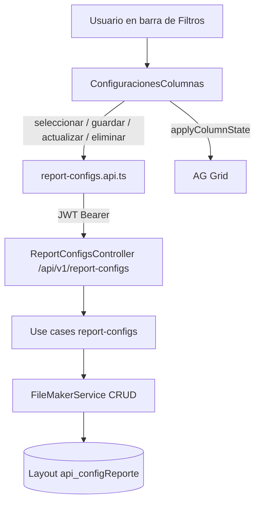
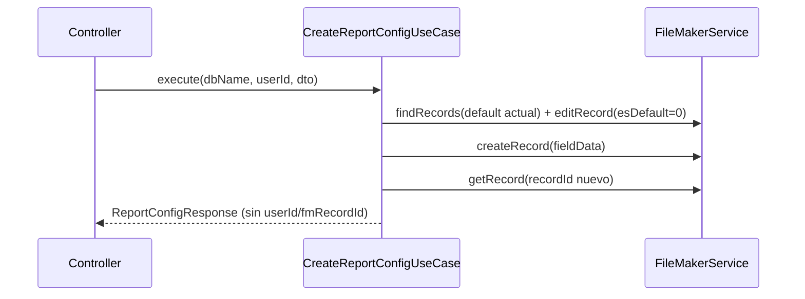
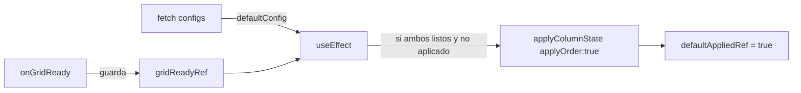

# DOC-11 — Configuraciones de columnas guardadas

**Tipo Jira:** Story / Task
**Epic:** [DOC] RepGen — Documentación técnica y operativa
**Component:** Reports / Frontend / FileMaker

**Resumen:** Funcionalidad que permite a cada usuario guardar varias configuraciones de columnas (visibilidad, orden, ancho, sort) por reporte, marcar una como predeterminada y reaplicarlas. Es transversal: nuevo layout FileMaker, módulo backend `report-configs` y UI en la barra de filtros.

---

### SUB-11.1 — Visión y flujo E2E

**Summary Jira:** `[DOC-11.1] Visión y flujo E2E configuraciones de columnas`

## Objetivo

Documento hub que explica qué resuelve la feature y enlaza el flujo completo UI → API → FileMaker.

## Problema que resuelve

Antes, las columnas visibles se perdían al recargar. Ahora cada usuario guarda configuraciones nombradas por reporte y la marcada como predeterminada se auto-aplica al entrar.

## Conceptos clave

- **Configuración:** snapshot del estado de columnas del grid (`api.getColumnState()`): `colId`, `hide`, `width`, `sort`, `sortIndex`, `pinned`.
- **Scope:** por **usuario** (`userId` del JWT) + **reporte** (`reportId`). El tenant es la propia base FileMaker.
- **`reportId` usados:** `bancos`, `ventas_facturas`, `ventas_conceptos`.

## Diagrama



## Criterios de aceptación

- [ ] Diagrama E2E + enlace a este archivo en la subtarea Jira
- [ ] Lista de `reportId` soportados
- [ ] Enlaces a SUB-11.2 … SUB-11.7

---

### SUB-11.2 — FileMaker: layout `api_configReporte`

**Summary Jira:** `[DOC-11.2] Layout FileMaker api_configReporte`

## Objetivo

Documentar la estructura de la tabla/layout que persiste las configuraciones.

## Layout

`api_configReporte` (constante `REPORT_CONFIG_LAYOUT`).

## Campos

| Campo FileMaker | Dominio | Tipo | Notas |
|-----------------|---------|------|-------|
| `_id_configRec` | `id` | Number (serial) | PK propia |
| `_idu_userRec` | `userId` | Number | FK al usuario |
| `configReporte_idReporte` | `reportId` | Text | `bancos`, `ventas_facturas`, `ventas_conceptos` |
| `configReporte_nombre` | `name` | Text | Nombre que escribe el usuario |
| `configReporte_columnsJSON` | `columnState` | Text | JSON de `api.getColumnState()` |
| `configReporte_esDefault` | `isDefault` | Number | `0` / `1` |
| `configReporte_fechaCreacion` | `createdAt` | Timestamp | Auto-enter creación |
| `configReporte_fechaModificacion` | `updatedAt` | Timestamp | Auto-enter modificación |

## Ubicación en código

| Archivo | Rol |
|---------|-----|
| `repgen-backend/src/report-configs/infrastructure/report-config-field-map.ts` | Mapa dominio ↔ campo FM + `REPORT_CONFIG_LAYOUT` |

## Notas

- No hay campo `tenant`: el aislamiento multi-tenant lo da la base FileMaker a la que se conecta (derivada del JWT).
- La unicidad del «default» (un solo `esDefault=1` por usuario+reporte) **no** es declarativa en FM; se garantiza en la capa de aplicación (ver SUB-11.3).

## Criterios de aceptación

- [ ] Tabla de campos verificada contra `report-config-field-map.ts` en `main`
- [ ] Sin datos reales de cliente
- [ ] Nota sobre unicidad del default y ausencia de campo tenant

---

### SUB-11.3 — Backend: módulo `report-configs`

**Summary Jira:** `[DOC-11.3] Backend módulo report-configs`

## Objetivo

Documentar la API REST y los casos de uso del CRUD de configuraciones.

## Controller

`src/report-configs/presentation/report-configs.controller.ts` — base path `/api/v1/report-configs` (protegido por `JwtAuthGuard` global). Lee `req.tenant` (dbName) y `req.id` (userId) del JWT.

| Método | Ruta | Use case | Código |
|--------|------|----------|--------|
| GET | `/report-configs?reportId=` | `GetReportConfigsUseCase` | 200 |
| POST | `/report-configs` | `CreateReportConfigUseCase` | 201 |
| PATCH | `/report-configs/:id` | `UpdateReportConfigUseCase` | 200 |
| DELETE | `/report-configs/:id` | `DeleteReportConfigUseCase` | 204 |

## DTOs

- `CreateReportConfigDto` — `reportId`, `name`, `columnState`, `isDefault?`
- `UpdateReportConfigDto` — `name?`, `columnState?`, `isDefault?`

## Reglas de negocio

- **Ownership:** update y delete buscan el registro por `_id_configRec` y lanzan `ForbiddenException` si `userId` no coincide; `NotFoundException` si no existe.
- **Default único:** al crear/actualizar con `isDefault=true`, `clearExistingDefault` busca los `esDefault=1` del mismo usuario+reporte y los pone en `0` antes de marcar el nuevo.
- **Respuesta limpia:** los use cases devuelven `ReportConfigResponse` = `Omit<ReportConfigRecord, 'fmRecordId' | 'userId'>`. El descarte se hace con `const { userId: _userId, fmRecordId, ...response } = mapReportConfigRecord(raw)` (habilitado por la regla ESLint `no-unused-vars` con `ignoreRestSiblings: true`).

## Ubicación en código

| Capa | Ruta |
|------|------|
| Controller | `presentation/report-configs.controller.ts` |
| DTOs | `presentation/dto/{create,update}-report-config.dto.ts` |
| Use cases | `application/{get,create,update,delete}-report-config*.use-case.ts` |
| Tipos | `domain/report-config.types.ts` |
| Field map | `infrastructure/report-config-field-map.ts` |
| Mapper | `infrastructure/report-config.mapper.ts` |
| Módulo | `report-configs.module.ts` (registrado en `app.module.ts`) |

## Diagrama (crear con isDefault=true)



## Criterios de aceptación

- [ ] Tabla endpoint → use case → código HTTP
- [ ] Documentadas reglas ownership + default único
- [ ] Nota sobre `ignoreRestSiblings` en respuesta
- [ ] Enlace a specs (SUB-11.7)

---

### SUB-11.4 — Backend: métodos CRUD en FileMakerService

**Summary Jira:** `[DOC-11.4] FileMakerService createRecord/editRecord/getRecord`

## Objetivo

Documentar los métodos genéricos del `FileMakerService` añadidos para soportar el CRUD (antes solo existía `deleteRecord`).

## Métodos

| Método | Verbo / endpoint Data API | Devuelve |
|--------|---------------------------|----------|
| `createRecord(dbName, layout, fieldData)` | POST `.../layouts/{layout}/records` | `CreateRecordResponse` (`recordId`) |
| `editRecord(dbName, layout, recordId, fieldData)` | PATCH `.../records/{recordId}` | `EditRecordResponse` (`modId`) |
| `getRecord(dbName, layout, recordId)` | GET `.../records/{recordId}` | `GetRecordResponse` (`data[]`) |

## Patrón común

Reutilizan el patrón de `deleteRecord`: obtener token cacheado → ejecutar → si responde `401`, reautenticar (`authFileMaker`) y reintentar una vez → en error, log + `InternalServerErrorException`.

> **Nota importante:** FileMaker maneja dos identificadores distintos: el `recordId` interno de la Data API (devuelto por `createRecord`) y el campo serial `_id_configRec`. Tras crear, `CreateReportConfigUseCase` usa `getRecord(recordId)` con el **recordId interno** para recuperar el registro recién creado.

## Ubicación en código

| Archivo | Rol |
|---------|-----|
| `repgen-backend/src/filemaker/filemaker.service.ts` | `createRecord`, `editRecord`, `getRecord` |
| `repgen-backend/src/filemaker/ifilemaker.ts` | `CreateRecordResponse`, `EditRecordResponse`, `GetRecordResponse` |

## Criterios de aceptación

- [ ] Tabla método → endpoint Data API
- [ ] Documentado retry en 401
- [ ] Nota recordId interno vs `_id_configRec`

---

### SUB-11.5 — Frontend: ConfiguracionesColumnas + useReportConfigs

**Summary Jira:** `[DOC-11.5] UI ConfiguracionesColumnas y hook`

## Objetivo

Documentar la UI de gestión de configuraciones (vive en la barra de Filtros) y el hook de datos.

## Componente

`src/components/Reportes/Filtros/ConfiguracionesColumnas.tsx`

- **Selector** (`<select>`): al elegir una config se aplica al grid con `api.applyColumnState({ state, applyOrder: true })` y se sincroniza `columnasVisibles`.
- **Menú ⋮:** acciones de la config activa — **Actualizar** (sobrescribe nombre + `getColumnState()`), **Predeterminar**, **Eliminar** (con confirmación inline).
- **«Guardar como…»:** popover con input → `createReportConfig`.
- **Feedback:** `react-hot-toast` (`<Toaster>` ya montado en `src/layout/Layout.tsx`).
- **Cierre de popovers:** overlay invisible `fixed inset-0` (patrón de `DrawerFiltros`).
- **Inicialización:** el selector arranca en la config predeterminada usando **ajuste de estado durante el render** (no `useEffect`; la regla `react-hooks/set-state-in-effect` lo prohíbe).
- **Fuente de verdad:** el estado real del grid (`api.getColumnState()`) — fuera del modal no existe el concepto de «borrador».

## Hook

`src/shared/hooks/useReportConfigs.ts` — devuelve `{ configs, defaultConfig, refresh, cargando }`.

## Auto-aplicar la predeterminada (al cargar)

`ReporteBancos.tsx` y `ReporteVentas.tsx` consumen `useReportConfigs(reportId)` y aplican la config default cuando **grid y datos** están listos, resolviendo la race condition con dos refs:



En `ReporteVentas` el `reportId` deriva del tipo (`ventas_facturas` / `ventas_conceptos`) y se resetea `defaultAppliedRef` al cambiar de pestaña.

## Ubicación en código

| Archivo | Rol |
|---------|-----|
| `components/Reportes/Filtros/ConfiguracionesColumnas.tsx` | Selector + menú ⋮ + popover guardar |
| `shared/hooks/useReportConfigs.ts` | Carga de configs por reporte |
| `components/Reportes/ReporteBancos.tsx` | `reportId="bancos"` + auto-apply default |
| `components/Reportes/ReporteVentas/ReporteVentas.tsx` | `reportId` derivado + reset por pestaña |

## Criterios de aceptación

- [ ] Diagrama del auto-apply (race condition) documentado
- [ ] Tabla de acciones del menú ⋮
- [ ] Nota: inicialización sin `useEffect`

---

### SUB-11.6 — Frontend: cliente API + ModalColumnas / Filtros

**Summary Jira:** `[DOC-11.6] API client report-configs y cambios ModalColumnas`

## Objetivo

Documentar el cliente HTTP de configuraciones y el reacomodo de responsabilidades en la barra.

## Cliente API

`src/features/reports/shared/api/report-configs.api.ts` — patrón de `column-labels.api.ts` (fetch + `Authorization: Bearer` desde `localStorage.jwt_reportes`).

| Función | Método → URL |
|---------|--------------|
| `fetchReportConfigs(reportId)` | GET `/report-configs?reportId=` |
| `createReportConfig(reportId, name, columnState, isDefault)` | POST `/report-configs` |
| `updateReportConfig(id, patch)` | PATCH `/report-configs/:id` |
| `deleteReportConfig(id)` | DELETE `/report-configs/:id` |

## Reacomodo de responsabilidades

- **`ModalColumnas.tsx`** vuelve a su rol original: **solo** mostrar/ocultar columnas (se le retiró el panel de configuraciones).
- **`Filtros.tsx`** recibe `reportId`, `configs`, `onConfigsChange` y los entrega a `ConfiguracionesColumnas` (en la fila de acciones, junto a Métricas/Columnas/Exportar).

## Ubicación en código

| Archivo | Rol |
|---------|-----|
| `features/reports/shared/api/report-configs.api.ts` | Cliente HTTP CRUD |
| `components/Reportes/Filtros/Filtros.tsx` | Thread de props a `ConfiguracionesColumnas` |
| `components/Reportes/Filtros/ModalColumnas.tsx` | Solo visibilidad de columnas |

## Criterios de aceptación

- [ ] Tabla función → método → URL
- [ ] Nota: `ModalColumnas` ya no gestiona configuraciones
- [ ] `ReportConfigResponse` (FE) no declara `userId`/`fmRecordId`

---

### SUB-11.7 — Tests (backend + frontend)

**Summary Jira:** `[DOC-11.7] Tests configuraciones de columnas`

## Objetivo

Inventario de pruebas que cubren la feature y cómo ejecutarlas.

## Backend (Jest)

| Spec | Cubre |
|------|-------|
| `filemaker/filemaker.service.spec.ts` | `createRecord`, `editRecord` (retry 401), `getRecord` |
| `report-configs/application/get-report-configs.use-case.spec.ts` | Listado, vacío, error → `[]` |
| `report-configs/application/create-report-config.use-case.spec.ts` | Crear + `clearExistingDefault` |
| `report-configs/application/update-report-config.use-case.spec.ts` | Ownership (Forbidden/NotFound), update |
| `report-configs/application/delete-report-config.use-case.spec.ts` | Ownership + delete |

```bash
cd repgen-backend
npx jest report-configs
npx jest filemaker
```

## Frontend (Vitest)

| Spec | Cubre |
|------|-------|
| `components/Reportes/Filtros/ConfiguracionesColumnas.test.tsx` | Selector aplica, guardar como, predeterminar, eliminar, ⋮ deshabilitado |
| `components/Reportes/Filtros/Filtros.test.tsx` | Mock de `ConfiguracionesColumnas` + props nuevas |

```bash
cd repgen-frontend
pnpm test
```

## Criterios de aceptación

- [ ] Inventario de specs verificado en `main`
- [ ] Comandos de ejecución documentados
- [ ] Nota: specs de use cases mockean `FileMakerService` (no tocan FM real)
