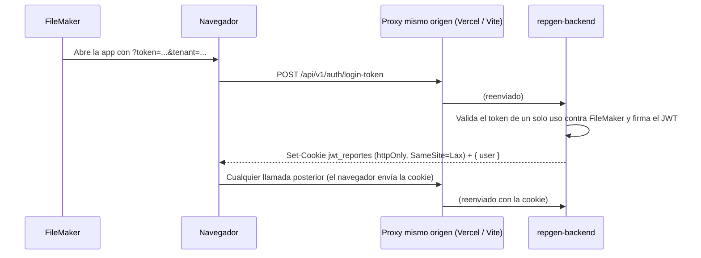

# Autenticación: sesión con JWT en cookie httpOnly

Cómo entra un usuario a RepGen y cómo se mantiene su sesión. Cubre backend y
frontend.

## Flujo

1. FileMaker abre la app con un token de un solo uso y el tenant (nombre de la
   base) en la URL.
2. `POST /auth/login-token` lo valida contra FileMaker, firma un JWT con
   `id`, `user`, `role` y `tenant`, y lo deja en la cookie `jwt_reportes`. El
   cuerpo solo devuelve `user` (no sensible).
3. En cada petición, `JwtAuthGuard` (global) verifica firma y expiración y
   pone `req.id`, `req.user`, `req.role` y `req.tenant`. El tenant y el
   usuario **siempre** salen de ahí, nunca del cuerpo ni de la query.

El JWT es stateless: FileMaker solo se consulta al canjear el token.

## Por qué cookie y por qué proxy

- **Cookie httpOnly:** JavaScript no puede leerla, así que un XSS no puede
  robar el token.
- **Proxy del mismo origen:** frontend (Vercel) y backend (DigitalOcean) están
  en dominios distintos. Una cookie entre sitios necesitaría
  `SameSite=None`, que Safari y varios modos de privacidad bloquean. El
  navegador siempre habla con su propio origen (`/api/...`) y quien reenvía es
  el rewrite de `repgen-frontend/vercel.json` en producción o el proxy de
  `repgen-frontend/vite.config.ts` en desarrollo (`DEV_API_PROXY_TARGET`, por
  defecto `http://localhost:3000`). Por eso `VITE_API_URL` es la ruta relativa
  `/api/v1`.

## Cookie

| Atributo | Valor |
|---|---|
| Nombre | `jwt_reportes` (`src/auth/auth.constants.ts`) |
| `httpOnly` | `true` |
| `secure` | solo con `NODE_ENV=production` (en desarrollo el proxy sirve por HTTP) |
| `sameSite` | `lax` |
| `maxAge` | `JWT_EXPIRES_IN` segundos (por defecto 3600), el mismo valor con que se firma el JWT |
| `path` | `/` |

## Endpoints (`src/auth/auth.controller.ts`)

| Método | Ruta | Público | Qué hace |
|---|---|---|---|
| POST | `/auth/login-token` | sí | Canjea `{ token, tenant }` por la cookie. Límite: 5 por minuto. |
| GET | `/auth/me` | no | `{ ok: true }` si la cookie sigue vigente; si no, el guard responde 401. |
| POST | `/auth/logout` | sí | Borra la cookie. Público para poder llamarse con la sesión ya expirada. |

El guard lee primero la cookie y, si no está, acepta `Authorization: Bearer
<jwt>`. Ese respaldo sirve para `curl` y scripts.

## Frontend

| Archivo | Rol |
|---|---|
| `src/features/auth/AuthGate.tsx` | Al cargar: si la URL trae `token`, hace login; si no, confirma la sesión con `GET /auth/me`. |
| `src/features/auth/session.ts` | Guarda en `localStorage["usuario:v1"]` solo `{ name, tenant }`: pista de que puede haber sesión y nombre para el navbar. |
| `src/shared/api/http.ts` | `apiFetch`: URL base, `credentials: "include"` y errores como `ApiError`. Un 401 emite `EVENTO_SESION_EXPIRADA`. |
| `src/features/auth/AvisoSesionExpirada.tsx` | Avisa sin recargar: lo que ya está en pantalla se puede seguir filtrando y exportando. |
| `src/app/layout/Navbar.tsx` | Cerrar sesión llama a `POST /auth/logout` (JavaScript no puede borrar la cookie). |

## Desarrollo

Con `MASTER_KEY` definida en el `.env` del backend se puede entrar sin
FileMaker con `?token=<MASTER_KEY>&tenant=<base>`. En producción no funciona.

## Si se quiere una sesión más larga

Hoy la sesión dura lo que el JWT. Extenderla con revocación (refresh tokens)
requiere persistencia, que este backend no tiene.
