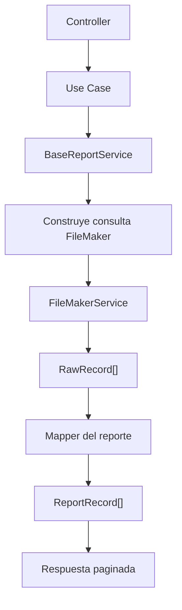

# Explicacion Funcional Del Flujo De Reportes

Este documento explica el recorrido real de los reportes desde la consulta a FileMaker hasta la salida final que consume la API. La idea es complementar el codigo con contexto funcional, reglas de negocio y decisiones que no conviene repetir dentro de cada metodo.

## 1) Flujo General

El flujo principal es este:

Resumen del flujo:

1. El controller recibe `globalSearch`, `filterModel` y `dateRange`.
2. El use case delega la consulta al `BaseReportService`.
3. El servicio base construye la consulta de FileMaker y revisa cache.
4. FileMaker devuelve registros crudos (`RawRecord`).
5. El mapper transforma esos registros en el formato del reporte.
6. La API responde con datos limpios y metadatos.

## 2) Contratos De Datos

Los dos tipos base que debes tener en mente son:

### `RawRecord`

Representa la respuesta cruda de FileMaker.

- `fieldData`: campos principales del registro.
- `portalData`: datos de portales, cuando existen.

### `FilterModel`

Representa un filtro generado por la UI.

- `filterType`: tipo de filtro, por ejemplo `text` o `number`.
- `type`: operador, por ejemplo `equals`, `greaterThan`, `empty`.
- `filter`: valor concreto del filtro.

## 3) Que Hace `BaseReportService`

El servicio base centraliza la parte repetida entre reportes:

- construye la cache key;
- arma la consulta para FileMaker;
- aplica filtros y rango de fechas;
- pide los datos a `FileMakerService`;
- llama al mapper específico del reporte;
- devuelve una respuesta con `data` y `meta`.

### Regla importante

El servicio base no conoce la lógica de negocio del reporte. Solo sabe:

- donde consultar;
- como filtrar;
- como cachear;
- que funcion usar para limpiar los datos.

## 4) Que Hace El Mapper De Tu Reporte

El archivo `{nombre-reporte}.mapper.ts` convierte registros crudos en registros listos para el reporte.

### Paso a paso (Ejemplo de reporte de ventas)

1. Valida que el registro crudo tenga la estructura esperada.
2. Mapea los campos limpios usando el field map.
3. Construye un registro base con defaults seguros.
4. Calcula campos derivados como:
   - `facturaGranTotalOriginal`
   - `pagoGranTotalMxn`
   - `facturaTasaPagada`
   - `facturaEstatus`
5. Si existe información de cliente, completa los datos fiscales y clasificadores.
6. Si la factura fue cancelada dentro del rango, agrega un registro negativo adicional.
7. Si existe una devolución, agrega un segundo registro con el formato de devolución.

## 5) Clear reglas del negocio

### Ejemplo de Ventas

### A. Factura normal

Si no hay cancelación ni devolución relevante, el registro sale una sola vez con los datos base.

### B. Cancelacion

Si existe `fechaCFDICancelado` y esa fecha cae dentro del rango consultado, el comportamiento depende también de la fecha de emisión de la factura:

- si la factura original también cae dentro del rango, se devuelven el registro original y el registro cancelado;
- si la factura original queda fuera del rango, se devuelve solo el registro cancelado.

En ambos casos el registro cancelado:

- se clona desde el registro limpio;
- se marca como `Cancelada`;
- se invierten los montos a negativo;
- se limpian los importes pagados y saldos.

Esto evita que una factura emitida fuera del periodo sume facturación en la consulta actual, pero sí permite registrar el efecto contable de la cancelación dentro del rango consultado.

### C. Devolucion

Si existe portal de devolución:

- se clona el registro original;
- se reemplazan los datos con la información de la nota de crédito;
- se fija el estatus `Devolución`;
- se ajustan montos, fechas y observaciones;
- se devuelve el registro original y el de devolución.

Si la fecha de la devolución cae dentro del rango consultado y la factura original queda fuera, se conserva solo el registro de devolución para no sumar la venta original en ese periodo.

## 6) Donde Mirar El Codigo (Ventas)

- Contratos base: [src/reports/domain/reports.types.ts](../../../src/reports/domain/reports.types.ts)
- Servicio común: [src/reports/application/shared/base-report.service.ts](../../../src/reports/application/shared/base-report.service.ts)
- Mapeo de ventas: [src/reports/infrastructure/sales/sales.mapper.ts](../../../src/reports/infrastructure/sales/sales.mapper.ts)
