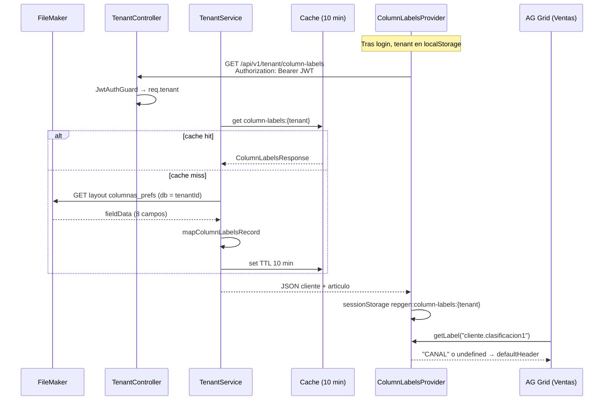

# Etiquetas de columnas por tenant (Column Labels)

Documentación funcional y técnica del flujo **DOC-4.4**: personalización de encabezados de columnas en reportes según la configuración de cada cliente (tenant) en FileMaker.

---

## 1. Objetivo de negocio

Cada tenant puede usar nombres distintos para sus clasificaciones de **cliente** (ej. Canal, Ruta, Zona) y de **artículo** (ej. Línea, Familia, Subfamilia). Esos nombres viven en FileMaker; RepGen los expone a la UI para que AG Grid muestre encabezados correctos sin redeploy del frontend.

| Sin column labels | Con column labels |
|-------------------|-------------------|
| Encabezado fijo «Clasificación 1» | Encabezado «CANAL» (valor del tenant) |
| Mismo texto para todos los clientes | Texto por base de datos FM (`tenant`) |

---

## 2. Conceptos

| Concepto | Descripción |
|----------|-------------|
| **Tenant** | Nombre de la base FileMaker / cliente; viaja en el JWT (`payload.tenant`) y en login (`?tenant=`). |
| **Slot** | Identificador lógico `grupo.clave`, ej. `cliente.clasificacion1`, `articulo.categoria2`. |
| **labelSlot** | Propiedad en `ventas.schema.json` que enlaza una columna del reporte con un slot. |
| **defaultHeader** | Texto en español genérico si no hay etiqueta en FM o falla la API. |
| **Layout FM `columnas_prefs`** | Origen de datos; un registro con los 8 textos de preferencia. |

Slots soportados hoy (8 en total):

```text
cliente.clasificacion1 … cliente.clasificacion4
articulo.categoria1    … articulo.categoria4
```

Slots válidos: los `labelSlot` de `features/reports/sales/ventas.schema.json` (`cliente.clasificacion1..4`, `articulo.categoria1..4`), resueltos por `resolverSlot` en `column-labels.context.ts`.

---

## 3. Flujo de extremo a extremo



### Orden en la aplicación

1. Usuario entra desde FileMaker con `?token=…&tenant=miBase`.
2. `POST /auth/login-token` genera JWT con `tenant: dbName`.
3. `app/App.tsx` monta `<ColumnLabelsProvider tenant={tenant}>` dentro de `AuthGate`, ya con sesión.
4. El provider llama `GET /tenant/column-labels` con el JWT.
5. `ReporteVentas` usa `useColumnLabels().getLabel` al construir columnas.
6. `ColumnBuilder` usa `labelSlot` + `labelResolver` → `headerName` final.

---

## 4. API REST

### Request

```http
GET /api/v1/tenant/column-labels HTTP/1.1
Host: localhost:3000
Authorization: Bearer <jwt>
```

- **Autenticación:** obligatoria (`JwtAuthGuard`).
- **Tenant:** no va en query; se toma de `req.tenant` (claim del JWT).
- **Throttle:** límite global del app (100 req/min), sin throttle específico.

### Response 200 — `ColumnLabelsResponse`

```json
{
  "cliente": {
    "clasificacion1": "CANAL",
    "clasificacion2": "RUTA",
    "clasificacion3": "ZONA",
    "clasificacion4": ""
  },
  "articulo": {
    "categoria1": "LÍNEA",
    "categoria2": "FAMILIA",
    "categoria3": "SUBFAMILIA",
    "categoria4": ""
  }
}
```

- Strings vacíos si FM no tiene valor o solo espacios (el mapper hace `trim`).
- El frontend trata cadena vacía como «sin etiqueta» y cae en `defaultHeader`.

### Errores

| Código | Cuándo | Mensaje típico |
|--------|--------|----------------|
| 401 | Sin JWT o inválido | Token no proporcionado / Token inválido |
| 400 | `req.tenant` vacío | Tenant ID is required |
| 404 | Sin registros en `columnas_prefs` | No column labels found |
| 5xx | FM caído / sin sesión | Error FileMaker (vía `FileMakerService`) |

---

## 5. Backend

### Archivos

| Archivo | Rol |
|---------|-----|
| `tenant/presentation/tenant.controller.ts` | Endpoint HTTP |
| `tenant/tenant.service.ts` | Cache + llamada FM + orquestación |
| `tenant/domain/column-labels.ts` | Tipos `ColumnLabelsRecord`, `ColumnLabelsResponse` |
| `tenant/infrastructure/column-labels-field-map.ts` | Nombres reales de campos FM |
| `tenant/infrastructure/column-labels.mapper.ts` | Record → Response |
| `filemaker/relations/_column-labels.ts` | Prefijos de relación para campos portal |
| `filemaker/filemaker.service.ts` | `getAllRecords(tenantId, 'columnas_prefs')` |

### FileMaker

- **Base de datos:** `tenantId` (mismo string que en login/JWT).
- **Layout:** `columnas_prefs`.
- **Operación:** `getAllRecords` — se usa el **primer registro** (`data[0]`).
- Si no hay registros → `NotFoundException`.

### Relaciones (`_column-labels.ts`)

```typescript
export const columnLabelsRelations = {
  _: `_prefCLIENTE`,           // campos cliente en layout principal
  prefInv: {
    _: `_prefCliente_|_pref.invITM_|_x`,  // campos artículo vía relación
  },
};
```

### Field map (campos FM)

| Slot API (cliente) | Campo FileMaker (simplificado) |
|--------------------|--------------------------------|
| clasificacion1–4 | `classify1_name_v0_20_0` … `classify4_name_v0_20_0` en pref cliente |
| categoria1–4 | `…::classify1_name_v0_20_0` … en relación `prefInv` |

Código: `column-labels-field-map.ts` (construye nombres con `columnLabelsRelations`).

### Caché

| Parámetro | Valor |
|-----------|--------|
| Clave | `column-labels:{tenantId}` |
| TTL al guardar | 10 minutos (`10 * 60 * 1000` ms) |
| Store | `@nestjs/cache-manager` (`CacheModule` en `TenantModule`) |

Tras cambiar textos en FileMaker, el cambio puede tardar hasta 10 min en API o hay que invalidar cache / reiniciar instancia.

### Mapper

`mapColumnLabelsRecord`:

- Agrupa 8 campos planos del record en `cliente.*` y `articulo.*`.
- `empty()` → `trim` o `''`.

Tests: `column-labels.mapper.spec.ts`.

---

## 6. Frontend

### Archivos

| Archivo | Rol |
|---------|-----|
| `features/reports/shared/api/column-labels.api.ts` | `fetchColumnLabels()` |
| `features/reports/shared/column-labels/ColumnLabelsProvider.tsx` | Estado, fetch, cache local |
| `features/reports/shared/column-labels/column-labels.context.ts` | Context, `resolverSlot`, sessionStorage |
| `features/reports/shared/column-labels/useColumnLabels.ts` | Hook `getLabel`, `labels`, `isLoading` |
| `app/App.tsx` | Monta el provider con el tenant de la sesión (tras `AuthGate`) |
| `features/reports/shared/ag-grid/construir-columnas.ts` | `resolverNombreEncabezado` |
| `features/reports/sales/ventas.schema.json` | `labelSlot` por columna |
| `features/reports/sales/columnas.ts` | `construirColumnasVentas(schema, getLabel)` |

### Montaje del provider

Solo cuando la autenticación fue exitosa:

```tsx
<AuthGate>
  {({ tenant, reporteInicio }) => (
    <ColumnLabelsProvider tenant={tenant}>
      <AppRouter reporteInicio={reporteInicio} />
    </ColumnLabelsProvider>
  )}
</AuthGate>
```

`tenantActivo` sale de `datos.user.tenant` tras login o de `localStorage.usuario`.

### Resiliencia

1. Al montar: lee `sessionStorage` (`repgen:column-labels:{tenant}`) para pintar rápido.
2. Fetch a API; si OK → actualiza estado y storage.
3. Si fetch falla pero hay cache en session → usa cache y guarda `error`.
4. `getLabel(slot)` → `undefined` si no hay texto → AG Grid usa `defaultHeader`.

### Resolución del encabezado (AG Grid)

En `construir-columnas.ag-grid.ts`:

```typescript
if (meta.labelSlot && labelResolver) {
  const etiqueta = labelResolver(meta.labelSlot);
  if (etiqueta) return etiqueta;
}
return meta.defaultHeader ?? encabezadoFallback;
```

### Ejemplo en schema (ventas)

```json
"clasificacion1": {
  "field": "clasificacion1",
  "dataType": "text",
  "columnClass": "Clientes",
  "defaultHeader": "Clasificación 1",
  "labelSlot": "cliente.clasificacion1"
}
```

**Reporte bancos:** hoy no declara `labelSlot` en su schema; solo **ventas** consume etiquetas dinámicas.

---

## 7. Tabla slot → columna ventas

| labelSlot | Campo dato (`field`) | defaultHeader |
|-----------|----------------------|---------------|
| `cliente.clasificacion1` | `clasificacion1` | Clasificación 1 |
| `cliente.clasificacion2` | `clasificacion2` | Clasificación 2 |
| `cliente.clasificacion3` | `clasificacion3` | Clasificación 3 |
| `cliente.clasificacion4` | `clasificacion4` | Clasificación 4 |
| `articulo.categoria1` | `categoriadeProducto1` | Categoría 1 |
| `articulo.categoria2` | `categoriadeProducto2` | Categoría 2 |
| `articulo.categoria3` | `categoriadeProducto3` | Categoría 3 |
| `articulo.categoria4` | `categoriadeProducto4` | Categoría 4 |

Los **valores de las celdas** vienen del reporte de ventas; los **encabezados** vienen de column labels.

---

## 8. Cómo extender

### Nuevo slot (requiere cambio en FM + API + FE)

1. Añadir campos en layout `columnas_prefs` y field map backend.
2. Extender `ColumnLabelsRecord` / `ColumnLabelsResponse`.
3. Añadir clave en `DYNAMIC_COLUMN_SLOTS` y `resolverSlot` (grupo nuevo si aplica).
4. Poner `labelSlot` en el `*.schema.json` del reporte.

### Nueva columna dinámica en ventas (solo UI)

1. En `ventas.schema.json`: `labelSlot` + `defaultHeader` en la columna.
2. Asegurar que el slot ya existe en la respuesta API.
3. `ReporteVentas` ya pasa `getLabel` — no requiere cambio si usa `construirColumnasVentas`.

---

## 9. Troubleshooting

| Síntoma | Revisar |
|---------|---------|
| Siempre «Clasificación 1» genérico | ¿API 200? ¿`labelSlot` en schema? ¿`getLabel` devuelve string no vacío? |
| 404 en API | ¿Existe registro en `columnas_prefs` para esa base? |
| 401 | JWT en `localStorage.jwt_reportes` |
| Etiquetas de otro tenant | `ColumnLabelsProvider` tiene `key={tenant}`; borrar `sessionStorage` `repgen:column-labels:*` |
| Cambio en FM no se ve | Cache backend 10 min; sessionStorage en pestaña |
| Encabezado con espacios raros | Mapper ya hace `trim` |

### Comandos / pruebas manuales

```bash
# Backend — test mapper
cd repgen-backend && pnpm test -- column-labels.mapper.spec

# API (sustituir TOKEN y TENANT)
curl -s -H "Authorization: Bearer TOKEN" \
  http://localhost:3000/api/v1/tenant/column-labels | jq
```

---

## 10. Seguridad

- Un usuario solo obtiene labels del **tenant embebido en su JWT**; no se acepta `tenant` por query en este endpoint.
- No incluir en logs de producción el JSON completo de labels si puede considerarse dato interno del cliente (hoy `TenantService` loguea la respuesta en nivel `log` — valorar reducir en prod).

---

## 11. Referencias cruzadas

- Login y JWT: `docs/jira/tasks/04-auth-tenant.md` (SUB-4.1, SUB-4.2)
- **Frontend (provider, AG Grid, tests):** `repgen-frontend/docs/COLUMN_LABELS_PROVIDER.md` (DOC-7.6)
- Reportes ventas: `docs/reports/workflow/EXPLICACION_FLUJO_REPORTES.md`
- Jira: `docs/jira/tasks/04-auth-tenant.md` (SUB-4.4)
