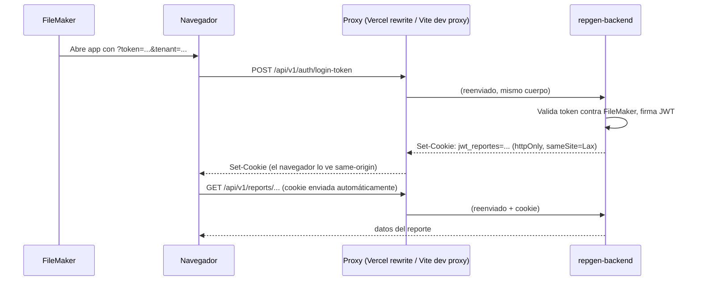

# Autenticación: JWT en cookie httpOnly + fix de memoización en TablaDinamica (DOC-9.1)

Documenta dos cambios aplicados en la misma sesión de limpieza de `react-doctor`:

1. **Migración del JWT de `localStorage` a una cookie httpOnly** (frontend + backend + deploy), para cerrar el hallazgo de seguridad `auth-token-in-web-storage`.
2. **Fix del hallazgo `react-compiler-no-manual-memoization`** en `TablaDinamica.tsx`, que había quedado pendiente porque un intento anterior de "simplemente borrar el `useCallback`" rompió el efecto que usa esa función.

Complementa `repgen-backend/docs/auth/AUTH_COOKIE_HTTPONLY.md` (visión desde el backend).

---

## 1. Por qué — el problema original

El JWT (`accessToken`) vivía en `localStorage` bajo la clave `jwt_reportes`, y cada llamada a la API lo leía manualmente para mandarlo como `Authorization: Bearer <token>`. Cualquier script inyectado vía XSS en la página puede leer `localStorage` sin restricciones — si alguna vez existe un vector XSS (una dependencia comprometida, un campo mal escapado, etc.), ese script puede robar el token y actuar como el usuario indefinidamente hasta que expire.

La corrección estándar es mover el token a una cookie `httpOnly`: el navegador la sigue mandando automáticamente en cada request, pero JavaScript no puede leerla ni escribirla — un XSS ya no puede exfiltrar el token.

## 2. Por qué no fue un cambio trivial

El frontend (`repgen-frontend`, Vercel) y el backend (`repgen-backend`, DigitalOcean: `https://repgenvbeta-gep97.ondigitalocean.app/`) están en **dominios distintos**. Una cookie cross-site necesita `SameSite=None; Secure`, que es exactamente el tipo de cookie que Safari (ITP) y varios modos de privacidad bloquean o descartan de forma intermitente — hubiera cambiado un riesgo teórico (XSS) por uno práctico (usuarios de Safari con sesiones inestables).

La solución fue agregar un **proxy same-origin**: el navegador siempre le habla a su propio origen (`/api/...`), y es Vercel (en producción) o Vite (en desarrollo) quien reenvía la petición al backend real por detrás. Así la cookie puede ser `SameSite=Lax`, la variante simple y ampliamente soportada, en ambos entornos.

## 3. Arquitectura resultante



- **Producción**: `repgen-frontend/vercel.json` agrega un `rewrite` de `/api/:path*` hacia `https://repgenvbeta-gep97.ondigitalocean.app/api/:path*`, antes del catch-all de SPA existente.
- **Desarrollo**: `repgen-frontend/vite.config.ts` agrega `server.proxy["/api"] → http://localhost:3000`.
- En ambos casos, `VITE_API_URL` pasa de ser una URL absoluta a una ruta relativa: `/api/v1`.

## 4. Qué cambió — frontend

| Archivo | Cambio |
| --- | --- |
| `vite.config.ts` | Proxy de dev `/api` → `localhost:3000` |
| `vercel.json` | Rewrite de `/api/:path*` → backend real (antes del catch-all SPA) |
| `.env` | `VITE_API_URL=/api/v1` (antes: URL absoluta a `localhost:3000`) |
| `src/features/auth/AuthGate.tsx` | Ya no guarda `accessToken` en `localStorage`. El login manda `credentials: "include"`. Para **retomar sesión** sin un token fresco de FileMaker (ej. al recargar la página), ya no puede leer el JWT de `localStorage` (es httpOnly) — ahora llama a `GET /auth/me`: 200 = sesión válida, 401 = no hay sesión. |
| `src/app/layout/Navbar.tsx` | `cerrarSesion` ahora llama a `POST /auth/logout` (que limpia la cookie en el servidor) antes de redirigir — JS ya no puede borrar una cookie httpOnly directamente. |
| `src/features/reports/shared/api/reportes.api.ts`, `src/features/reports/shared/api/report-configs.api.ts`, `src/features/reports/shared/api/column-labels.api.ts` | Se eliminó la lectura manual de `localStorage.getItem("jwt_reportes")` y el header `Authorization`. Se agregó `credentials: "include"` a cada `fetch`. |

`usuario:v1` (nombre y tenant, no sensible) **se mantiene** en `localStorage` — solo se movió el JWT. Sirve como pista rápida de "puede que haya sesión" antes de confirmar con `/auth/me`, y para mostrar el nombre en el navbar sin otra llamada de red.

## 5. Qué cambió — backend

Ver el detalle completo en `repgen-backend/docs/auth/AUTH_COOKIE_HTTPONLY.md`. Resumen:

- Nueva dependencia `cookie-parser`, activada en `main.ts`.
- `POST /auth/login-token` ahora pone el JWT en una cookie (`httpOnly`, `sameSite: "lax"`, `secure` solo en producción) en vez de devolverlo en el body. El body sigue devolviendo `user` (no sensible).
- Nuevos endpoints: `GET /auth/me` (confirma sesión vigente, protegido por el guard global) y `POST /auth/logout` (limpia la cookie).
- `JwtAuthGuard` ahora lee el token de la cookie primero, y cae al header `Authorization: Bearer` si no la encuentra (compatibilidad hacia atrás mientras no queden clientes viejos).

**No se necesitó base de datos.** El JWT sigue siendo stateless — FileMaker solo se consulta una vez, al validar el token de un solo uso; después de eso, verificar el JWT es pura criptografía (firma + expiración), sin ninguna consulta.

## 6. Verificación realizada

No fue solo "compila y los tests pasan" — se levantaron ambos servidores (`repgen-frontend` en `5273` con el proxy de Vite, `repgen-backend` en `3000`) y se probó el flujo real en el navegador:

1. **Login**: navegación con `?token=<MASTER_KEY>&tenant=demo` (atajo de desarrollo en `AuthService`, evita depender de FileMaker) → `POST /api/v1/auth/login-token` → `200 OK` → la app cargó el Reporte de Bancos con datos reales desde `POST /api/v1/reports/bancos/buscar` (también `200 OK`, autenticado solo por cookie).
2. **`document.cookie` desde la consola del navegador → `""`** — confirma que la cookie es invisible para JS pese a que el navegador la manda en cada request.
3. **Retomar sesión**: navegar a `/bancos` sin ningún parámetro de FileMaker en la URL → `GET /api/v1/auth/me → 200 OK` → la app cargó normalmente.
4. **Logout**: `GET /auth/me` (200) → `POST /auth/logout` (200) → `GET /auth/me` otra vez (**401**) — confirma que la cookie quedó completamente invalidada.
5. Suite completa de tests y `pnpm run build` en ambos repos, y un re-escaneo de `react-doctor` que confirmó la desaparición del hallazgo `auth-token-in-web-storage`.

## 7. Qué falta / decisiones pendientes

- **`no-fetch-in-effect`** (el `fetch` de login sigue viviendo en un `useEffect` de `AuthGate.tsx`) no se tocó en esta pasada — es un cambio de patrón (ej. un loader de React Router) independiente del tema de seguridad, y no fue parte de lo que se pidió resolver ahora.
- El `JWT_EXPIRES_IN` actual (por defecto 3600s = 1h) define el `maxAge` de la cookie. Si en el futuro se quiere sesión más larga con revocación (refresh tokens), **eso sí requeriría persistencia** (DB o similar) — no aplica a lo implementado aquí.
- El fallback a `Authorization: Bearer` en el guard puede eliminarse una vez se confirme que ningún cliente viejo (build cacheado, integración externa) sigue dependiendo de él.

---

## 8. Fix de `react-compiler-no-manual-memoization` en TablaDinamica.tsx

**Contexto:** en una pasada anterior de limpieza de `react-doctor` se había quitado el `useCallback` de `scheduleGridFit` (la función que ajusta el ancho de columnas de AG Grid en un `requestAnimationFrame` throttled) confiando en que React Compiler lo estabiliza automáticamente. Eso rompió el `useEffect` que la usa como dependencia — sin memoización, `scheduleGridFit` es una función nueva en cada render, así que el efecto desconectaba y reconectaba el `ResizeObserver` en cada render (un error real, no cosmético, que `react-doctor` marcó como `error`).

**Fix aplicado:** en vez de restaurar el `useCallback` (que dejaba el hallazgo del linter sin resolver), `scheduleGridFit` se movió fuera del componente, a una función de módulo que recibe los refs (`referenciaGrid`, `gridContainerRef`, `resizeRafRef`) como parámetros en vez de capturarlos en un closure:

```ts
// Antes: closure dentro del componente, necesitaba useCallback
const scheduleGridFit = useCallback(() => { ... }, [referenciaGrid]);

// Después: función pura de módulo, nunca se recrea
function scheduleGridFit(gridRef, containerRef, rafRef) { ... }
// ...dentro del componente:
scheduleGridFit(referenciaGrid, gridContainerRef, resizeRafRef);
```

Al ya no ser un valor definido dentro del componente, no hace falta memoizarla ni listarla como dependencia del efecto — React Compiler no necesita "adivinar" su estabilidad porque, técnicamente, ya no es parte del render. El mismo patrón (`prefer-module-scope-pure-function`) ya se había aplicado antes en `Navbar.tsx` y `ModalColumnas.tsx` para un problema similar.

**Verificado:** tests de `TablaDinamica.test.tsx`, `pnpm test` completo, `npx vite build`, y un re-escaneo de `react-doctor` que confirmó que el hallazgo desapareció sin reintroducir el error original del `ResizeObserver`.
