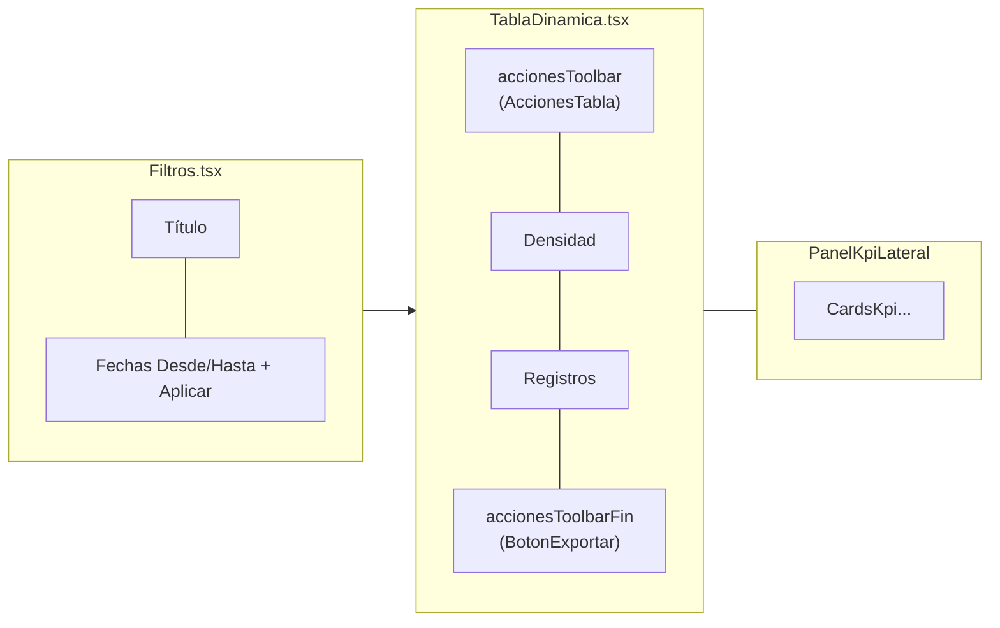

# Cambios en Reportes desde el PR #14 (post-merge a `main`)

> **Nota (2026-10-08):** registro histórico. Las rutas citadas (`src/components/Reportes/...`) cambiaron con la reorganización por features (Fase 2); ver [EVALUACION_ODATA_Y_ARQUITECTURA.md](../../docs/architecture/EVALUACION_ODATA_Y_ARQUITECTURA.md).

Resumen de todo lo que cambió en `repgen-frontend` desde que el PR #14
(`6cabfea`) se mezcló a `main`. `main` no se ha movido desde entonces; todo lo
de aquí vive en `feature/deploy-vercel` (20 commits) más los cambios locales
sin confirmar al momento de escribir este documento. Pensado como base para
la descripción del próximo PR.

Relacionado con **SUB-7.5** (componentes compartidos: tabla/filtros/KPI) y
**DOC-11** (configuraciones de columnas) del backlog en `repgen-docs`.

---

## 1. Resumen ejecutivo

| Área                                  | Qué cambió                                                                                                                          | Sección                                             |
| ------------------------------------- | ----------------------------------------------------------------------------------------------------------------------------------- | --------------------------------------------------- |
| Barra de herramientas de reportes     | Reordenada: fechas junto al título, acciones de columnas/config/export movidas a la barra de la tabla, panel de métricas colapsable | [§2](#2-reorganización-de-la-barra-de-herramientas) |
| Configuraciones de columnas guardadas | Feature completa (ya documentada aparte) + gating por tenant                                                                        | [§3](#3-configuraciones-de-columnas-guardadas)      |
| Dashboard de KPIs                     | Componente `CardsKpi` reutilizable, más métricas, colores semánticos                                                                | [§4](#4-dashboard-de-kpis)                          |
| Fixes                                 | Export solo columnas visibles, evitar peticiones redundantes, predicados AG Grid                                                    | [§5](#5-fixes)                                      |
| Estilos                               | Fuente Arial, colores de marca ERP                                                                                                  | [§6](#6-estilos)                                    |
| `DrawerFiltros` eliminado             | Quedó sin uso y se borró junto con su test                                                                                          | [§7](#7-drawerfiltros-eliminado)                    |

---

## 2. Reorganización de la barra de herramientas

**Motivación:** la barra original (`Filtros.tsx`) concentraba título, fechas,
`Columnas`, configuraciones guardadas, `Métricas` y `Exportar` en una sola
fila — visualmente saturada y con los controles de la tabla lejos de la
tabla. Se separaron responsabilidades: lo que pertenece al **reporte**
(título, fechas) queda en `Filtros`; lo que opera **sobre la tabla**
(columnas, config, export) se movió a `TablaDinamica`; las **métricas** se
convirtieron en un panel lateral colapsable.



### 2.1 Fechas junto al título

`Filtros.tsx` ya no delega el rango de fechas a un drawer aparte
(`DrawerFiltros`, ya eliminado, ver [§7](#7-drawerfiltros-eliminado)): los inputs `Desde` /
`Hasta` y el botón `Aplicar` están inline, a la derecha del título. En móvil
caen debajo del título (antes se traslapaban) usando
`flex-col sm:flex-row sm:justify-between`.

- `Aplicar` se deshabilita mientras el borrador de fechas sea igual a las
  fechas activas (`borradorFechas.fechaDesde === fechaDesde && ...`).
- Valida que `fechaDesde <= fechaHasta` (toast de error si no).

### 2.2 Slots de `TablaDinamica`

Para no acoplar el componente genérico de tabla a conceptos de reporte
(config/export), se le agregaron dos slots `ReactNode` en vez de threadear
props una por una:

```ts
interface TablaDinamicaProps<T> {
  // ...
  accionesToolbar?: React.ReactNode; // junto a Densidad/Registros
  accionesToolbarFin?: React.ReactNode; // al final, a la derecha del todo
}
```

Ambos se pintan en la misma fila que los selectores de **Densidad** (Compacto
/ Normal / Espacioso) y **Registros** (50/100/200/Todos) —
`src/components/Reportes/TablaDinamica/TablaDinamica.tsx`. El padre
(`ReporteBancos.tsx` / `ReporteVentas.tsx`) compone qué va en cada slot; la
tabla no conoce columnas guardadas ni exportación.

### 2.3 `AccionesTabla` (slot `accionesToolbar`)

`src/components/Reportes/Filtros/AccionesTabla.tsx` agrupa:

- Botón **Columnas** + `ModalColumnas` (mostrar/ocultar columnas).
- `ConfiguracionesColumnas` (selector + menú `⋮` + "Guardar como...") — solo
  si `useTenantFeatures().habilitarConfiguraciones` es `true` (ver [§3](#3-configuraciones-de-columnas-guardadas)).

```ts
interface AccionesTablaProps {
  referenciaGrid: React.RefObject<AgGridReact | null>;
  columnasVisibles: Column[];
  setColumnasVisibles: (val: Column[]) => void;
  reportId: string;
  configs: ReportConfigResponse[];
  onConfigsChange: () => Promise<void>;
}
```

### 2.4 `BotonExportar` (slot `accionesToolbarFin`)

`src/components/Reportes/Filtros/BotonExportar.tsx` — botón verde de
exportar, separado en su propio slot para garantizar que quede **siempre el
último a la derecha**, después de Densidad y Registros, sin importar qué más
se agregue a `accionesToolbar` en el futuro.

```ts
interface BotonExportarProps {
  referenciaGrid: React.RefObject<AgGridReact | null>;
  nombreArchivo: string;
}
```

Usa `exportarDatos()` de `utils/ag-grid/export.ag-grid.ts` (ver
[§5.1](#51-exportar-solo-columnas-visibles)).

### 2.5 Panel de métricas colapsable (`PanelKpiLateral`)

El botón "Métricas" que vivía en la barra se eliminó. En su lugar,
`PanelKpiLateral` (`src/components/Reportes/PanelKpiLateral/PanelKpiLateral.tsx`)
es ahora un panel que se colapsa a un **riel angosto** (`w-11`) con botón para
reabrir, en vez de desaparecer del todo:

| Prop nueva | Valores                                            | Efecto                                                       |
| ---------- | -------------------------------------------------- | ------------------------------------------------------------ |
| `lado`     | `"izquierda"` \| `"derecha"` (default `"derecha"`) | En qué borde de la tabla vive el panel y su manija de resize |

- **Abierto:** ancho configurable (`localStorage`, arrastrando el borde),
  contenido con scroll propio, botón "Ocultar".
- **Colapsado:** en `xl+` un riel vertical angosto con ícono + texto
  "Métricas" rotado; en pantallas chicas (sin espacio para un riel) un botón
  horizontal "Mostrar métricas" de ancho completo.
- El manejador de resize se ancla al borde que colinda con la tabla (derecha
  del panel si `lado="izquierda"`, izquierda si `lado="derecha"`), invirtiendo
  el signo del delta de arrastre según el lado.

Tanto `ReporteBancos.tsx` como `ReporteVentas.tsx` pasan `lado="derecha"`
explícitamente. `mostrarResumen` sigue arrancando en `true` (panel abierto por
defecto).

### 2.6 Ajustes de layout / mobile

- `ConfiguracionesColumnas.tsx`: el contenedor de sus tres controles (selector,
  `⋮`, "Guardar como...") pasó de `flex items-center gap-2 shrink-0` a
  `flex flex-wrap items-center gap-2` para que el botón "Guardar como..." baje
  de línea en vez de cortarse en pantallas angostas (~434px).
- Título + fechas de `Filtros.tsx`: contenedor cambiado a
  `flex-col sm:flex-row sm:justify-between` para que no se traslapen en móvil.

---

## 3. Configuraciones de columnas guardadas

Feature completa (guardar/aplicar/renombrar/predeterminar/eliminar vistas de
columnas por usuario+reporte) ya documentada en detalle en
[`docs/MODULO_CONFIGURACIONES_COLUMNAS.md`](./MODULO_CONFIGURACIONES_COLUMNAS.md)
(arquitectura FE/BE/FileMaker, diagramas de secuencia, endpoints). No se
repite aquí; solo lo que quedó **fuera** de ese documento porque llegó
después:

- **`useTenantFeatures` (`bbf71fd`):** hook con caché a nivel de módulo
  (`_featuresPromise`) que llama `GET /tenant/features` una sola vez por
  sesión, sin importar cuántos componentes lo usen. `ConfiguracionesColumnas`
  ahora se muestra solo si `habilitarConfiguraciones` es `true` — permite
  activar la feature por tenant sin flag de build.
- **`693bc03`:** `useReportConfigs` usa un contador de "trigger" + flag de
  cancelación para ignorar respuestas de fetch en vuelo si el componente se
  desmontó o cambió `reportId`, evitando updates de estado obsoletos.

---

## 4. Dashboard de KPIs

- **`CardsKpi` (`a7f0677`, `a432d07`):** componente reutilizable
  (`src/components/Reportes/PanelKpiLateral/CardsKpi.tsx`) que reemplaza las
  tarjetas de KPI que antes estaban duplicadas entre Ventas y Bancos. Recibe
  `{ titulo, valor: { cantidad, tipo, tipoDeUnidades? }, color: { positivo,
negativo }, icono }` y formatea moneda/porcentaje/unidades con `Intl` vía
  `toLocaleString('es-MX', ...)`.
- **Paleta de colores (`c28c3c2`):** se agregaron variantes `navy`, `emerald`,
  `sky` a `CLASES_COLOR` para dar colores más semánticos por métrica (ej.
  Total Facturado vs. Cancelaciones vs. Flujo Neto).
- **`6d796d3`:** el dashboard de Ventas se amplió con más métricas.
- **Aviso a nivel de panel (`9dd0d37`):** el badge informativo (ej. "Solo
  MXN") se movió de ser una prop por-tarjeta (`mostrarAviso`/`textoAviso` en
  `CardsKpi`) a una única prop `aviso` en `PanelKpiLateral`, mostrada una sola
  vez en el header del panel en vez de repetirse en cada card.

---

## 5. Fixes

### 5.1 Exportar solo columnas visibles

`1696561` — `exportarDatos()` (`utils/ag-grid/export.ag-grid.ts`) llama
`api.exportDataAsCsv({ allColumns: false, ... })` en vez de exportar todas las
columnas del grid, incluyendo las ocultas por el usuario.

### 5.2 Evitar solicitudes redundantes por filtros de columna

`d8ed935` — los filtros de AG Grid (floating filters por columna) se aplican
**client-side**; no deben disparar una petición nueva al backend. Se quitó el
debounce y el callback `onFiltroCambiado` de `ReporteBancos`, `ReporteVentas`
y `TablaDinamica`. Después se quitó también `modeloFiltros`: `useReporteBase`
ya no envía filtros de columna al backend, solo el rango de fechas.

### 5.3 Predicados de AG Grid

`0cc4fb7` — AG Grid pasa los valores de filtro como arreglo a los predicados
custom; `filtroIgual` ahora desestructura `[valorFiltro]` en vez de recibir el
valor directo. También se renombró la `displayKey` `"empty"` a `"blank"` para
alinearla con la clave nativa de AG Grid y evitar problemas al renderizar las
opciones del filtro.

---

## 6. Estilos

- **`15a0ac6`:** Arial como fuente por defecto en toda la app y en AG Grid
  (`--ag-font-family`).
- **`1ab0d92`:** tokens de marca ERP en `src/index.css` —
  `--color-blue-500/600/700` (`#4a8bec` / `#2b75e8` / `#1e5fc4`, sustituyen el
  azul default de Tailwind) y `--color-marca-morado` (`#623bea`) para estados
  `hover` en botones primarios.

---

## 7. `DrawerFiltros` eliminado

Desde que el rango de fechas se alineó en `Filtros.tsx` (§2.1), el drawer
quedó sin consumidores. Al principio se dejó para filtros futuros, pero
`DrawerFiltros.tsx` y su test se eliminaron (`0f6d2b6`). Si más adelante se
necesitan filtros adicionales, se construyen desde cero.

---

## 8. Archivos clave tocados

| Archivo                                                                                      | Rol                                                            |
| -------------------------------------------------------------------------------------------- | -------------------------------------------------------------- |
| `src/components/Reportes/Filtros/Filtros.tsx`                                                | Título + fechas inline                                         |
| `src/components/Reportes/Filtros/AccionesTabla.tsx`                                          | Columnas + Configuraciones (slot `accionesToolbar`)            |
| `src/components/Reportes/Filtros/BotonExportar.tsx`                                          | Exportar (slot `accionesToolbarFin`)                           |
| `src/components/Reportes/Filtros/ConfiguracionesColumnas.tsx`                                | Selector/menú/guardar config (sin cambios de fondo, solo wrap) |
| `src/components/Reportes/TablaDinamica/TablaDinamica.tsx`                                    | Slots `accionesToolbar` / `accionesToolbarFin`                 |
| `src/components/Reportes/PanelKpiLateral/PanelKpiLateral.tsx`                                | Panel colapsable con riel, prop `lado`                         |
| `src/components/Reportes/PanelKpiLateral/CardsKpi.tsx`                                       | Tarjeta de KPI reutilizable                                    |
| `src/shared/hooks/useTenantFeatures.ts`                                                      | Gating de features por tenant                                  |
| `src/components/Reportes/ReporteBancos/ReporteBancos.tsx`, `ReporteVentas/ReporteVentas.tsx` | Wiring de todo lo anterior                                     |

---

## 9. Verificación

```bash
cd repgen-frontend
npx vitest run   # 12 archivos, 33 tests
npx tsc --noEmit
npx eslint src
```

Validado también manualmente en preview a 434px (mobile) y 1280px (desktop)
en Reporte de Bancos y Reporte de Ventas: fechas junto al título sin
traslape, acciones de tabla sin cortes, panel de métricas colapsa/expande sin
tapar la tabla.
