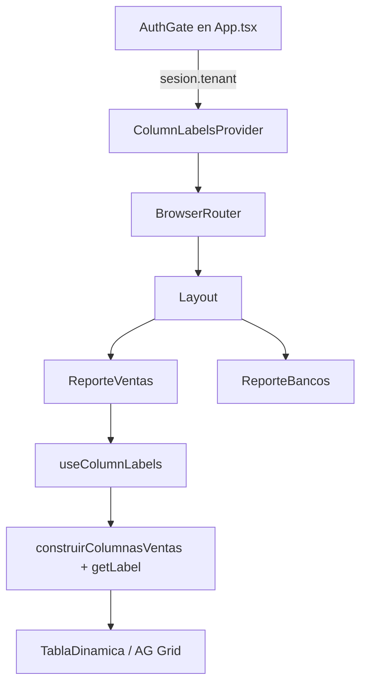

# ColumnLabelsProvider — Frontend (DOC-7.6)

Guía del módulo React que carga y distribuye **etiquetas dinámicas de columnas** por tenant. Complementa la documentación backend/E2E en `repgen-backend/docs/tenant/COLUMN_LABELS.md` (DOC-4.4).

---

## 1. Objetivo en la UI

El usuario no debe ver textos genéricos («Clasificación 1», «Categoría 2») si su empresa ya definió nombres en FileMaker. El provider:

1. Obtiene esas etiquetas del API tras el login.
2. Las guarda en memoria y en `sessionStorage` por tenant.
3. Expone `getLabel(slot)` para que AG Grid arme `headerName` según el schema del reporte.

**Consumidor actual:** reporte de **ventas** (`ReporteVentas`). Bancos y otras pantallas no usan `useColumnLabels` hoy.

---

## 2. Ubicación en el árbol React



El provider envuelve **toda la app autenticada**, no solo ventas. Así cualquier ruta futura puede usar el mismo contexto sin volver a fetchear.

Montaje (`src/app/App.tsx`):

```tsx
<AuthGate>
  {({ tenant, reporteInicio }) => (
    <ColumnLabelsProvider tenant={tenant}>
      <AppRouter reporteInicio={reporteInicio} />
    </ColumnLabelsProvider>
  )}
</AuthGate>
```

---

## 3. Estructura de archivos

```
src/features/reports/shared/
├── api/
│   └── column-labels.api.ts      # GET vía apiFetch + tipo ColumnLabelsResponse
├── column-labels/
│   ├── column-labels.context.ts  # Context, storage, resolverSlot, labelsVacias
│   ├── ColumnLabelsProvider.tsx  # Provider + efectos
│   └── useColumnLabels.ts        # Hook de consumo
└── ag-grid/
    └── construir-columnas.ts     # LabelResolver → headerName

src/features/reports/sales/
├── ventas.schema.json            # labelSlot por columna
└── columnas.ts                   # construirColumnasVentas(schema, getLabel)
```

---

## 4. Contrato del contexto

Tipo exportado: `ColumnLabelsContextValue` (`column-labels.context.ts`).

| Propiedad | Tipo | Descripción |
|-----------|------|-------------|
| `labels` | `ColumnLabelsResponse` | Objeto completo `cliente` + `articulo` |
| `isLoading` | `boolean` | `true` mientras el fetch inicial o `refreshLabels` está en curso |
| `error` | `string \| null` | Mensaje si falló el último fetch (puede haber labels de cache igualmente) |
| `getLabel` | `(slot: string) => string \| undefined` | Resuelve `cliente.clasificacion1`, etc. |
| `refreshLabels` | `() => Promise<void>` | Reintenta fetch manual (útil tras cambios en FM) |

### Formato `ColumnLabelsResponse`

```typescript
{
  cliente: {
    clasificacion1: string;
    clasificacion2: string;
    clasificacion3: string;
    clasificacion4: string;
  };
  articulo: {
    categoria1: string;
    categoria2: string;
    categoria3: string;
    categoria4: string;
  };
}
```

Tipo único en `@repgen/shared-types` (`packages/shared-types/index.d.ts`); FE y BE lo importan de ahí.

---

## 5. Ciclo de vida del provider

### 5.1 Origen del `tenant`

| Momento | Fuente de `tenantActivo` |
|---------|--------------------------|
| Login desde FM (`?token=&tenant=`) | `datos.user.tenant` tras `POST /auth/login-token` |
| Sesión ya guardada | `localStorage["usuario:v1"]` (respaldo: `usuario`) → JSON `{ name, tenant }`, confirmada con `GET /auth/me` |
| Sin tenant | `null` → labels vacías, sin fetch |

El JWT vive en la cookie httpOnly `jwt_reportes` (el frontend no puede leerlo); en `localStorage` solo quedan datos no sensibles del usuario (`features/auth/session.ts`). El fetch de labels **no** envía tenant en URL: el backend lo lee del JWT.

### 5.2 Inicialización (`useState`)

```typescript
const [labels, setLabels] = useState(() => estadoInicialLabels(tenant));
const [isLoading, setIsLoading] = useState(() => Boolean(tenant));
```

- Si hay tenant y existía cache en `sessionStorage` → pinta labels al instante (sin esperar red).
- Clave storage: `repgen:column-labels:{tenant}`.

### 5.3 Fetch al montar (`useEffect` depende de `[tenant]`)

1. Si `!tenant` → no hace nada.
2. `fetchColumnLabels()` → `GET {VITE_API_URL}/tenant/column-labels`.
3. OK → `setLabels` + `guardarEnStorage(tenant, respuesta)`.
4. Error → intenta `leerDesdeStorage(tenant)`; si hay cache, la usa y setea `error`.
5. Cleanup `activo = false` evita actualizar estado si el componente se desmontó.

### 5.4 Cambio de tenant (`key` en el wrapper)

```tsx
<ColumnLabelsProviderInner key={tenant ?? "__sin-tenant__"} tenant={tenant}>
```

Al cambiar de tenant, React **remonta** el inner provider: estado fresco, nuevo fetch, sin mezclar labels de otro cliente.

### 5.5 `refreshLabels`

Misma lógica que el fetch del efecto, pero invocable desde UI (hoy no hay botón expuesto; está disponible en el contexto para uso futuro).

---

## 6. API cliente (`column-labels.api.ts`)

```typescript
export const fetchColumnLabels = (): Promise<ColumnLabelsResponse> =>
  apiFetch<ColumnLabelsResponse>("/tenant/column-labels");
```

`apiFetch` (`src/shared/api/http.ts`) pone la URL base, envía la cookie de sesión con `credentials: "include"` y convierte respuestas no-OK en `ApiError`. Un 401 emite `EVENTO_SESION_EXPIRADA` (aviso de sesión expirada, sin recargar). No hay encabezado `Authorization`.

| Variable | Uso |
|----------|-----|
| `VITE_API_URL` | Base del API en build (Vercel / `.env`); por defecto `/api/v1` (mismo origen, vía proxy) |

---

## 7. Resolución de slots (`resolverSlot`)

```typescript
// slot ejemplo: "cliente.clasificacion1"
const [grupo, clave] = slot.split(".");
// grupo === "cliente" | "articulo"
// devuelve undefined si string vacío tras trim
```

`getLabel` en el provider es un `useCallback` que delega aquí y depende de `[labels]`.

**Importante:** si `getLabel` devuelve `undefined`, AG Grid usa `defaultHeader` del schema (ver siguiente sección).

---

## 8. Integración con AG Grid (ventas)

### 8.1 En `ReporteVentas.tsx`

```typescript
const { getLabel } = useColumnLabels();

const columnasReportes = useMemo(
  () => construirColumnasVentas(schemaReportType, getLabel),
  [schemaReportType, getLabel],
);
```

- `schemaReportType`: `"factura"` | `"conceptos"` (ruta `/ventas/facturas` vs `/ventas/conceptos`).
- Cuando llegan labels del API, cambia `labels` → cambia `getLabel` → **se recalculan columnas** y AG Grid actualiza encabezados.

`isLoading` y `error` del contexto **no se usan aún** en `ReporteVentas` (la tabla puede mostrarse con `defaultHeader` hasta que termine el fetch). Mejora posible: spinner o skeleton en encabezados mientras `isLoading`.

### 8.2 En `construir-columnas.ts`

```typescript
export type LabelResolver = (labelSlot: string) => string | undefined;

const resolverNombreEncabezado = (fallback, meta, labelResolver?) => {
  if (meta.labelSlot && labelResolver) {
    const etiqueta = labelResolver(meta.labelSlot);
    if (etiqueta) return etiqueta;
  }
  return meta.defaultHeader ?? fallback;
};
```

### 8.3 Ejemplo antes / después

| labelSlot | defaultHeader | FM devuelve | headerName en grid |
|-----------|---------------|-------------|-------------------|
| `cliente.clasificacion1` | Clasificación 1 | `CANAL` | **CANAL** |
| `cliente.clasificacion1` | Clasificación 1 | `""` o sin API | **Clasificación 1** |
| `articulo.categoria1` | Categoría 1 | `LÍNEA` | **LÍNEA** |

Columnas **sin** `labelSlot` en `ventas.schema.json` ignoran el provider y usan solo `defaultHeader` o la clave del schema.

---

## 9. Capas de fallback (resiliencia)

```text
1. labels en React state (último fetch OK)
      ↓ si falla fetch
2. sessionStorage repgen:column-labels:{tenant}
      ↓ si no hay cache o slot vacío
3. defaultHeader en ventas.schema.json
      ↓ si no hay defaultHeader
4. Nombre de clave en schema (columnKey)
```

| Escenario | Comportamiento UI |
|-----------|-------------------|
| Primera visita, API lenta | Encabezados genéricos → luego se actualizan al completar fetch |
| API 404, sin cache | Genéricos + `error` en contexto (no visible en ventas hoy) |
| API falla, hay cache de sesión anterior | Encabezados del tenant desde cache |
| Usuario cambia de tenant (otro login) | Remount por `key` + nueva clave storage |

---

## 10. Hook `useColumnLabels`

```typescript
export const useColumnLabels = () => {
  const context = useContext(ColumnLabelsContext);
  if (!context) {
    throw new Error("useColumnLabels debe usarse dentro de ColumnLabelsProvider");
  }
  return context;
};
```

**Regla:** solo llamar dentro del árbol bajo `ColumnLabelsProvider` (después de login exitoso). Llamarlo en `App.tsx` antes de auth lanzará error.

---

## 11. Cómo usar en un componente nuevo

```typescript
import { useColumnLabels } from "@/features/reports/shared/column-labels/useColumnLabels";
import { construirColumnasVentas } from "@/features/reports/sales/columnas";

function MiReporte() {
  const { getLabel, isLoading, refreshLabels } = useColumnLabels();
  const columnDefs = useMemo(
    () => construirColumnasVentas("factura", getLabel),
    [getLabel],
  );
  // ...
}
```

Para otro reporte:

1. Añadir `labelSlot` en su `*.schema.json`.
2. Pasar `getLabel` al `ColumnBuilder` de ese reporte (mismo patrón que ventas).
3. No hace falta un provider adicional.

---

## 12. Tests

`ReporteVentas.test.tsx` mockea el hook (no monta el provider real):

```typescript
vi.mock('../shared/column-labels/useColumnLabels', () => ({
  useColumnLabels: () => ({
    labels: { cliente: { … }, articulo: { … } },
    isLoading: false,
    error: null,
    getLabel: (slot: string) => map[slot],
    refreshLabels: vi.fn(),
  }),
}));
```

Para probar el provider en aislamiento haría falta:

- Mock de `fetch` global o `column-labels.api`.
- `render` con `<ColumnLabelsProvider tenant="testTenant">` + componente hijo que lea `labels` / `getLabel`.

---

## 13. Troubleshooting (solo frontend)

| Síntoma | Causa probable | Acción |
|---------|----------------|--------|
| Error al usar hook | Componente fuera del provider | Montarlo dentro de `AuthGate` (ver `app/App.tsx`) |
| Siempre defaultHeader | Sin `labelSlot` en schema | Revisar `ventas.schema.json` |
| Labels de otro cliente | Storage antiguo | Cerrar pestaña o limpiar `sessionStorage` `repgen:column-labels:*` |
| Encabezados no actualizan | `useMemo` sin `getLabel` en deps | Incluir `getLabel` como en `ReporteVentas` |
| 401 en Network | Cookie `jwt_reportes` ausente o expirada (DevTools → Application → Cookies) | Re-login desde FileMaker |
| Cambió FM, UI igual | Cache backend 10 min + sessionStorage | `refreshLabels()` o nueva sesión |

### Depuración rápida en consola del navegador

```javascript
// Ver cache del tenant actual
JSON.parse(sessionStorage.getItem("repgen:column-labels:" + JSON.parse(localStorage.getItem("usuario:v1")).tenant))

// Ver usuario y tenant guardados
JSON.parse(localStorage.getItem("usuario:v1"))

// ¿Sigue viva la sesión? (la cookie httpOnly no es visible desde JS)
fetch("/api/v1/auth/me", { credentials: "include" }).then((r) => r.status) // 200 ok, 401 expirada
```

---

## 14. Relación con DOC-4.4

| Tema | DOC-4.4 (backend / E2E) | DOC-7.6 (este doc) |
|------|-------------------------|---------------------|
| FileMaker layout | Sí | Referencia |
| API contrato | Sí | Consumo vía `apiFetch` |
| Provider React | Mención | **Detalle completo** |
| AG Grid | Mención | **Detalle completo** |
| Tests FE | No | Sí |

---

## 15. Mejoras futuras (no implementadas)

- [ ] Mostrar `isLoading` / `error` en UI de ventas
- [ ] Botón «Actualizar etiquetas» → `refreshLabels()`
- [ ] Usar labels en reporte bancos u otros schemas
- [ ] Tests unitarios de `ColumnLabelsProvider` y `resolverSlot`
- [ ] Invalidar sessionStorage al logout explícito

---

## Referencias

- Backend / E2E: `repgen-backend/docs/tenant/COLUMN_LABELS.md`
- Jira: `docs/jira/tasks/07-frontend.md` (SUB-7.6)
- Slots en schema: `src/features/reports/sales/ventas.schema.json`
