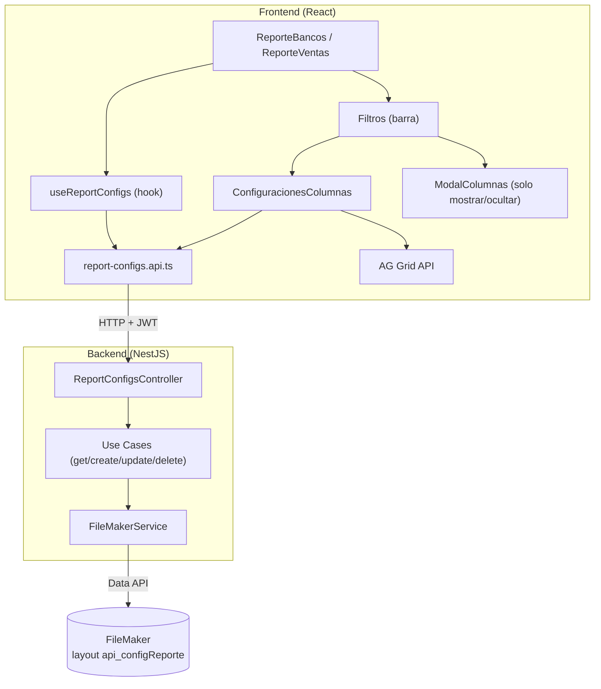
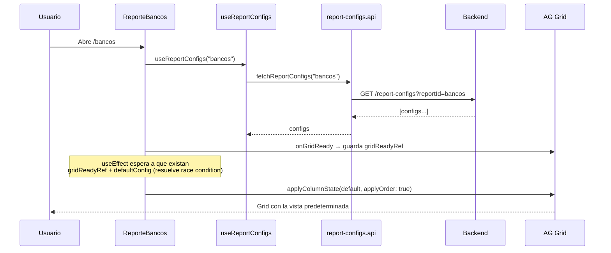
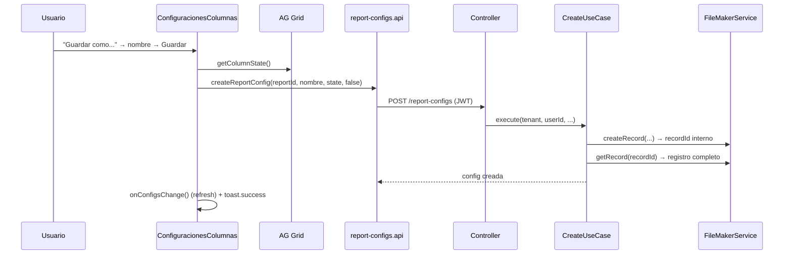
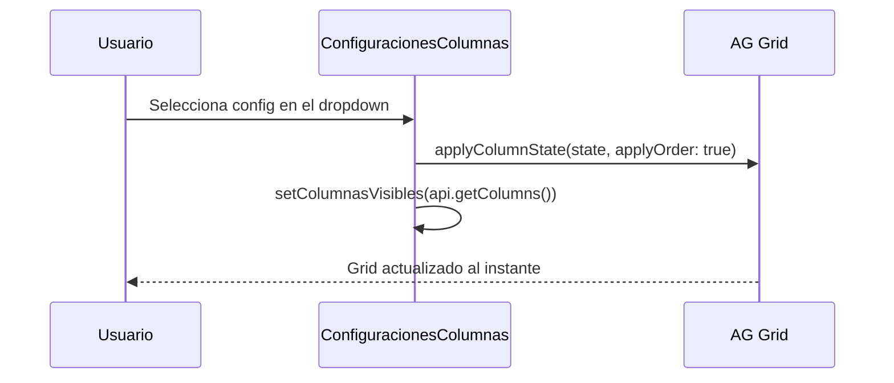
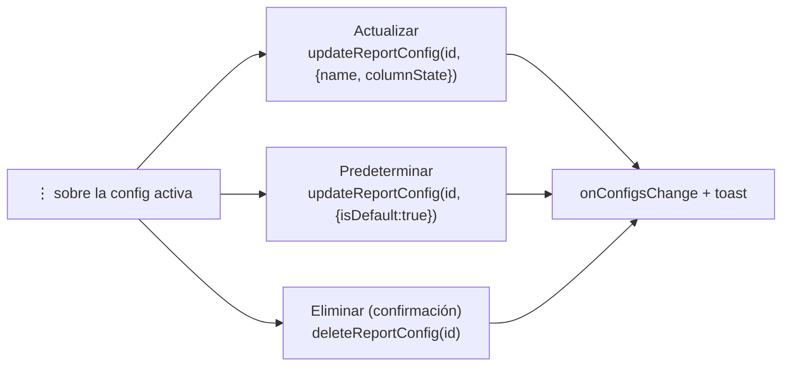

# Módulo: Configuraciones de Columnas Guardadas (DOC-8.1)

Guía completa del módulo que permite a cada usuario **guardar, aplicar y gestionar configuraciones de columnas** (visibilidad, orden, ancho, sort) por reporte. Cubre frontend (React + AG Grid), backend (NestJS) y persistencia (FileMaker).

---

## 1. Objetivo

Cada usuario puede tener varias "vistas" de columnas por reporte y marcar una como **predeterminada**, que se auto-aplica al abrir la pantalla. La gestión vive en la **barra de herramientas** del reporte (no dentro del modal de columnas).

- **Multi-tenant:** cada tenant es una base de datos FileMaker distinta; el aislamiento es automático (el `tenant` viaja en el JWT).
- **Por usuario:** las configs se filtran por `userId` (también del JWT) + `reportId`.

---

## 2. Arquitectura general



---

## 3. Estructura de archivos

### Frontend
```
src/
├── components/Reportes/Filtros/
│   ├── Filtros.tsx                    # Barra; thread de props reportId/configs/onConfigsChange
│   ├── ConfiguracionesColumnas.tsx    # ★ Selector + menú ⋮ + popover "Guardar como..."
│   └── ModalColumnas.tsx              # Solo mostrar/ocultar columnas
├── features/reports/shared/api/
│   └── report-configs.api.ts          # fetch/create/update/delete (HTTP + JWT)
└── shared/hooks/
    └── useReportConfigs.ts            # { configs, defaultConfig, refresh, cargando }
```

### Backend
```
src/
├── filemaker/
│   ├── filemaker.service.ts           # findRecords, getRecord, createRecord, editRecord, deleteRecord
│   └── ifilemaker.ts                  # Tipos de respuesta FM
└── report-configs/
    ├── presentation/
    │   ├── report-configs.controller.ts   # GET / POST / PATCH / DELETE
    │   └── dto/                            # Create/Update DTOs (class-validator)
    ├── application/
    │   ├── get-report-configs.use-case.ts
    │   ├── create-report-config.use-case.ts
    │   ├── update-report-config.use-case.ts
    │   └── delete-report-config.use-case.ts
    ├── domain/report-config.types.ts       # ReportConfigRecord, ColumnStateEntry
    ├── infrastructure/
    │   ├── report-config-field-map.ts      # nombre dominio → campo FM + REPORT_CONFIG_LAYOUT
    │   └── report-config.mapper.ts          # RawRecord FM → ReportConfigRecord
    └── report-configs.module.ts
```

---

## 4. Modelo de datos

### FileMaker — layout `api_configReporte`
| Campo FM | Dominio | Notas |
|---|---|---|
| `_id_configRec` | `id` | Serial propio (PK lógica) |
| `_idu_userRec` | `userId` | Dueño de la config |
| `configReporte_idReporte` | `reportId` | `bancos`, `ventas_facturas`, `ventas_conceptos` |
| `configReporte_nombre` | `name` | Nombre visible |
| `configReporte_columnsJSON` | `columnState` | JSON de `api.getColumnState()` |
| `configReporte_esDefault` | `isDefault` | 0 / 1 |
| `configReporte_fechaCreacion` / `_fechaModificacion` | `createdAt` / `updatedAt` | Auto-enter en FM |

### Tipo serializado (`ColumnStateEntry`)
```ts
{ colId, hide?, width?, sort?, sortIndex?, pinned?, aggFunc? }
```
Es la salida nativa de `api.getColumnState()` — captura visibilidad, ancho, orden y sort en un solo objeto.

---

## 5. Flujos clave

### 5.1 Cargar la página → auto-aplicar la predeterminada



**Punto clave (race condition):** el grid puede montar antes o después de que llegue la respuesta del API. `ReporteBancos`/`ReporteVentas` usan dos refs (`gridReadyRef` + `defaultAppliedRef`) y un `useEffect` que aplica el default **solo cuando ambos están listos**, una sola vez.

### 5.2 Guardar una configuración nueva



**Punto clave (recordId vs serial):** FileMaker devuelve un `recordId` interno al crear, distinto del campo serial `_id_configRec`. El use case recupera el registro recién creado con `getRecord(recordId)` — **no** con un `findRecords` por el serial.

### 5.3 Aplicar una configuración (selector)



**Punto clave (`applyOrder: true`):** restaura también el **orden** de columnas, no solo la visibilidad. El footer "Guardar" del modal usa `applyOrder: false` porque ahí solo se togglea visibilidad.

### 5.4 Actualizar / Predeterminar / Eliminar (menú ⋮)



**Punto clave (unicidad del default):** al setear `isDefault: true`, el use case primero busca y desmarca cualquier default previo del mismo usuario+reporte (FileMaker no tiene constraints declarativos). Mismo patrón en create y update.

**Punto clave (ownership):** update y delete verifican que `record.userId === userId` del JWT; si no, lanzan `ForbiddenException`.

---

## 6. Endpoints

| Método | Ruta | Use case | Notas |
|---|---|---|---|
| GET | `/report-configs?reportId=` | Get | Lista del usuario actual + reporte |
| POST | `/report-configs` | Create | Crea (y limpia default si `isDefault`) |
| PATCH | `/report-configs/:id` | Update | Renombra / actualiza estado / predetermina |
| DELETE | `/report-configs/:id` | Delete | Verifica ownership |

Todos protegidos por el `JwtAuthGuard` global → `req.tenant` (dbName) y `req.id` (userId).

---

## 7. Orden sugerido para leer el código

1. **Tipos y modelo:** `report-config.types.ts` + `report-config-field-map.ts` (qué se guarda).
2. **Backend de afuera hacia adentro:** `report-configs.controller.ts` → un use case (`create`) → `filemaker.service.ts` (`createRecord`/`getRecord`).
3. **Frontend de datos:** `report-configs.api.ts` → `useReportConfigs.ts`.
4. **Frontend de UI:** `ConfiguracionesColumnas.tsx` (toda la interacción) y cómo `Filtros.tsx` lo monta.
5. **Auto-aplicar default:** el `useEffect` con `gridReadyRef`/`defaultAppliedRef` en `ReporteBancos.tsx`.

---

## 8. Notas / decisiones de diseño

- **Estado del grid como fuente de verdad:** al vivir en la barra (fuera del modal) no hay "borrador"; se serializa directamente con `api.getColumnState()`.
- **Inicialización del selector sin `useEffect`:** el selector arranca en la config default mediante *ajuste de estado durante el render* (el lint `react-hooks/set-state-in-effect` prohíbe `setState` en efectos).
- **Cierre de popovers:** overlay invisible `fixed inset-0` (mismo patrón que `DrawerFiltros.tsx`); no hay librería de popovers.
- **Feedback:** `react-hot-toast` (el `<Toaster>` ya está montado en `Layout.tsx`).
